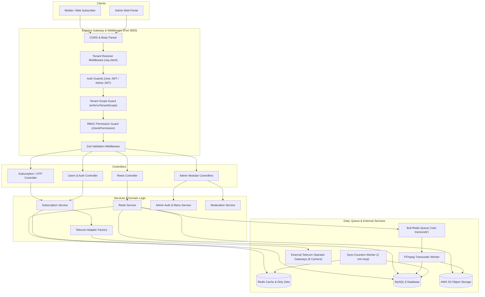
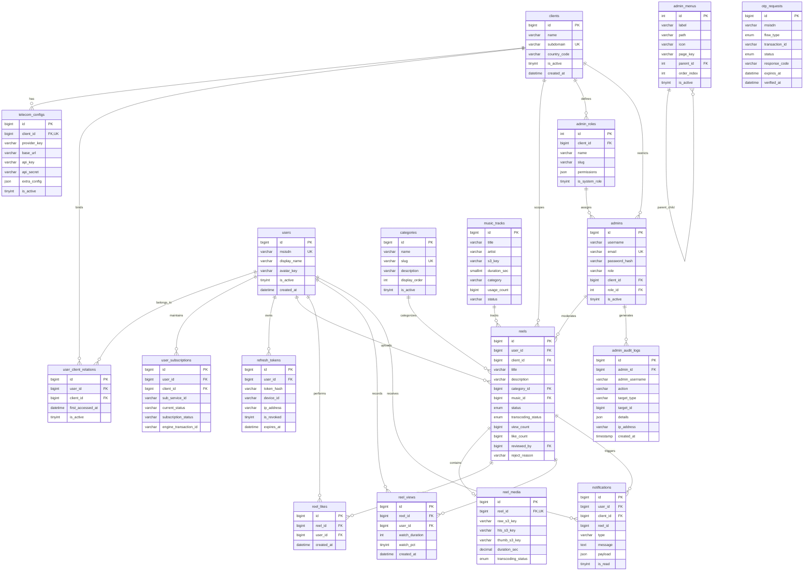
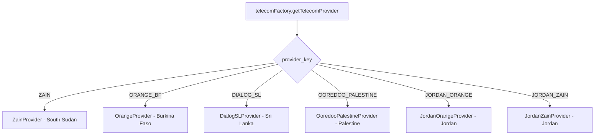
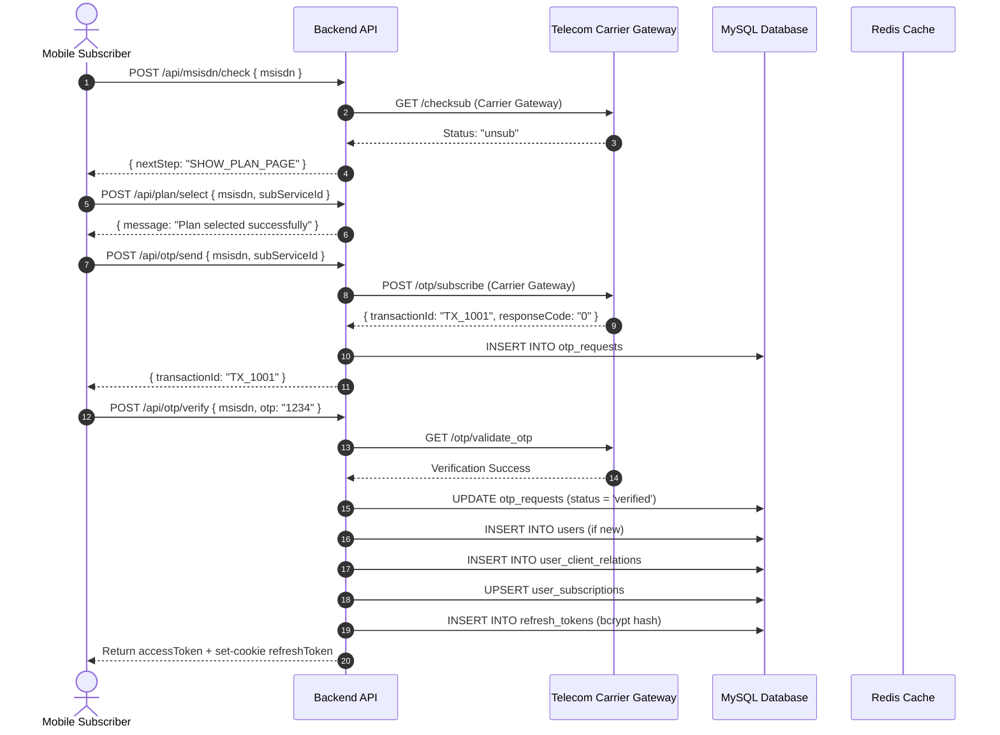
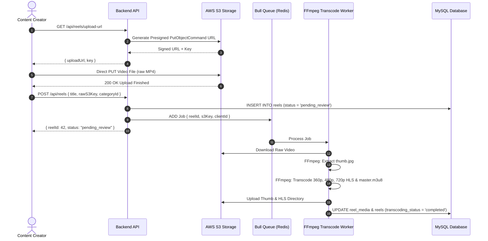
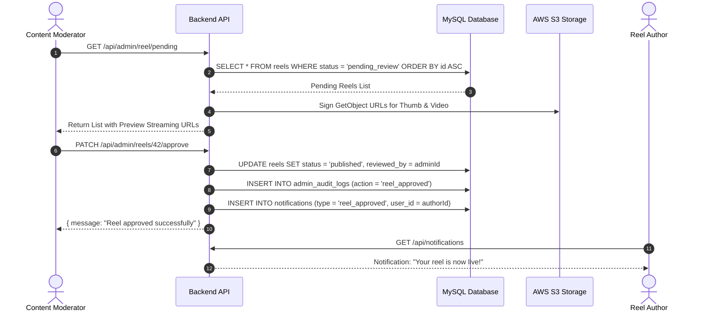

# TickHigh FitShort — Complete Backend Technical Documentation

**Platform:** TickHigh FitShort (Wellness360)  
**Version:** 1.0.0  
**Runtime:** Node.js (CommonJS) / Express 5  
**Database:** MySQL 8.x  
**Cache & Queue:** Redis 6+ / Bull  
**Cloud Storage & Media:** AWS S3 / FFmpeg  
**Last Updated:** October 2026  

---

## Table of Contents

1. [Project Overview](#1-project-overview)
2. [Tech Stack](#2-tech-stack)
3. [Architecture Overview](#3-architecture-overview)
4. [Folder Structure](#4-folder-structure)
5. [API Documentation](#5-api-documentation)
   - [5.1 Multi-Tenant & Common Headers](#51-multi-tenant--common-headers)
   - [5.2 Telecom Subscription & Status Endpoints](#52-telecom-subscription--status-endpoints)
   - [5.3 User Authentication & Profile Endpoints](#53-user-authentication--profile-endpoints)
   - [5.4 Reels & Feed Endpoints](#54-reels--feed-endpoints)
   - [5.5 Notifications Endpoints](#55-notifications-endpoints)
   - [5.6 Music & Audio Endpoints](#56-music--audio-endpoints)
   - [5.7 Admin Authentication & Dynamic Roles Endpoints](#57-admin-authentication--dynamic-roles-endpoints)
   - [5.8 Admin Reels Moderation Endpoints](#58-admin-reels-moderation-endpoints)
   - [5.9 Admin Team & User Management Endpoints](#59-admin-team--user-management-endpoints)
   - [5.10 Admin Categories, Leaderboard & Menus Endpoints](#510-admin-categories-leaderboard--menus-endpoints)
6. [Database Design](#6-database-design)
   - [6.1 Database Setup & Connection Pool](#61-database-setup--connection-pool)
   - [6.2 Entity-Relationship (ER) Diagram](#62-entity-relationship-er-diagram)
   - [6.3 Detailed Schema & Tables Specification](#63-detailed-schema--tables-specification)
7. [Authentication & Authorization](#7-authentication--authorization)
   - [7.1 End-User Telecom OTP & Session Management](#71-end-user-telecom-otp--session-management)
   - [7.2 Admin Email & Password Authentication](#72-admin-email--password-authentication)
   - [7.3 Dynamic RBAC (Role-Based Access Control) & Menu Generation](#73-dynamic-rbac-role-based-access-control--menu-generation)
   - [7.4 Multi-Tenant Scoping & Domain Enforcement](#74-multi-tenant-scoping--domain-enforcement)
8. [Middleware & Request Lifecycle](#8-middleware--request-lifecycle)
   - [8.1 Middleware Pipeline Execution Order](#81-middleware-pipeline-execution-order)
   - [8.2 Detailed Middleware Implementations](#82-detailed-middleware-implementations)
9. [Business Logic & Core Services](#9-business-logic--core-services)
   - [9.1 Subscription & Billing Workflow](#91-subscription--billing-workflow)
   - [9.2 Video Ingestion, S3 Presigning & HLS Transcoding](#92-video-ingestion-s3-presigning--hls-transcoding)
   - [9.3 Real-Time Engagement & Counter Synchronization](#93-real-time-engagement--counter-synchronization)
   - [9.4 Admin Content Moderation & Audit Trail](#94-admin-content-moderation--audit-trail)
10. [Validation & Error Handling](#10-validation--error-handling)
    - [10.1 Zod Validation Architecture](#101-zod-validation-architecture)
    - [10.2 Global Error Response & HTTP Status Codes](#102-global-error-response--http-status-codes)
11. [Third-Party Integrations](#11-third-party-integrations)
    - [11.1 AWS S3 (Media Storage & Presigned URLs)](#111-aws-s3-media-storage--presigned-urls)
    - [11.2 Telecom Operators (6 Supported Carrier Gateways)](#112-telecom-operators-6-supported-carrier-gateways)
12. [Background Jobs & Scheduled Tasks](#12-background-jobs--scheduled-tasks)
    - [12.1 Bull Transcoding Queue & FFmpeg Worker](#121-bull-transcoding-queue--ffmpeg-worker)
    - [12.2 Sync-Counters Worker (Redis dirty-sets to MySQL)](#122-sync-counters-worker-redis-dirty-sets-to-mysql)
13. [Security Measures](#13-security-measures)
14. [Environment & Configuration](#14-environment--configuration)
15. [Setup & Installation Guide](#15-setup--installation-guide)
16. [Logging, Monitoring & Testing](#16-logging-monitoring--testing)
17. [Deployment & DevOps](#17-deployment--devops)
18. [Sequence Diagrams](#18-sequence-diagrams)
19. [Performance & Best Practices](#19-performance--best-practices)
20. [Known Issues & Future Improvements](#20-known-issues--future-improvements)

---

## 1. Project Overview

### 1.1 Purpose & Role
**TickHigh FitShort** (internally branded as **Wellness360**) is a multi-tenant, short-form fitness video streaming, social engagement, and content moderation backend platform.

The system serves two distinct user classes:
1. **End-Users (Subscribers):** Mobile app and web users across diverse geographic regions who consume vertical short-form fitness reels, discover trending workout audio, like/view reels, upload custom fitness clips, and receive status notifications. Access is authenticated and billed via direct carrier billing (DCB) and telecom operator OTP gateways.
2. **Administrative Staff & Moderators:** Internal administrators, content curators, moderators, and auditors who monitor system statistics, approve/reject user-submitted reels, manage categories, curate audio tracks, configure dynamic role permissions, and review audit logs.

### 1.2 Core Modules & Services Provided to Frontend
* **Multi-Tenant Routing:** Automatic tenant resolution by incoming subdomain or `x-client-subdomain` header, isolating data across partner telecom operators.
* **Telecom Subscription & Direct Carrier Billing (DCB):** Verification of MSISDN subscription status, plan selection, subscription OTP dispatch/verification, unsubscription, and callback handling.
* **Authentication & Token Sessions:** Dual JWT architecture for users (OTP-based) and administrators (email/password with bcrypt), featuring access tokens (15m/30m) and refresh tokens stored as secure HTTP-only cookies and bcrypt hashes in the database.
* **Video Upload & Multi-Bitrate HLS Streaming:** AWS S3 presigned PUT URLs for direct video upload, asynchronous Bull worker queue transcoding via FFmpeg to 360p, 480p, 720p HLS segments, and signed S3 GET URLs for streaming.
* **Social Engagement & Real-Time Counters:** Like/unlike, view tracking with watch duration, Redis-backed atomic counters with periodic batch synchronization to the MySQL master tables.
* **Dynamic Admin Portal & RBAC:** Database-driven dynamic navigation menus, granular permissions, role creation, and audit trails.
* **In-App Notifications:** Real-time event notifications for reel approvals, rejections, suspensions, and likes.
* **Music Library:** Admin audio track management and user sound discovery.

---

## 2. Tech Stack

| Component | Technology | Version | Purpose |
|---|---|---|---|
| **Runtime** | Node.js | `>= 18.x` | JavaScript runtime environment (CommonJS modules) |
| **Framework** | Express | `5.2.1` | HTTP web server, routing, and middleware pipeline |
| **Database** | MySQL | `8.x` | Relational primary data store |
| **DB Driver / Pool** | `mysql2` | `^3.22.6` | Connection pooling (`mysql2/promise`) with prepared statements |
| **In-Memory Cache** | Redis / `ioredis` | `^5.x` | Real-time view/like counters, dirty sets, and tenant config caching |
| **Job Queue** | `bull` | `^4.16.5` | Redis-backed distributed task queue for video transcoding |
| **Object Storage** | AWS S3 | `@aws-sdk/client-s3 ^3.1087.0` | Video, audio, and thumbnail file storage |
| **S3 Presigner** | AWS S3 Request Presigner | `@aws-sdk/s3-request-presigner ^3.1087.0` | Generates secure temporary upload and download URLs |
| **Media Processing** | `fluent-ffmpeg` & `@ffmpeg-installer/ffmpeg` | `^2.1.3` / `^1.1.0` | Video transcoding to multi-bitrate HLS and thumbnail extraction |
| **Authentication** | `jsonwebtoken` | `^9.0.3` | HMAC SHA-256 JWT access and refresh token signing/verifying |
| **Password Hashing** | `bcrypt` | `^6.0.0` | Salted password hashing (cost factor 10) for admin credentials and refresh tokens |
| **Request Validation**| `zod` | `^4.4.3` | Schema definition and strict runtime request validation |
| **HTTP Client** | `axios` | `^1.18.1` | Outbound HTTP requests to telecom operator gateways |
| **Cookie Parsing** | `cookie-parser` | `^1.4.7` | Parses incoming HTTP cookies for refresh token retrieval |
| **UUID Generator** | `uuid` | `^14.0.1` | Generates unique S3 object keys and identifiers |
| **Process Manager / Dev** | `nodemon` | `^3.1.14` | Hot reloading during local development |

---

## 3. Architecture Overview

The backend employs a **Multi-Tenant Layered Monolith Architecture** adhering to the **Router-Controller-Service-Repository** pattern with dedicated asynchronous background queues.

### 3.1 Architectural Layers
1. **Network & Tenant Resolver Layer:** Extracts tenant context from the HTTP `Host` header or `x-client-subdomain` header, looking up active tenant configurations from Redis/MySQL.
2. **Security & Validation Layer:** Applies CORS, JSON body parsing, JWT token authentication, RBAC action checks, and Zod input validation.
3. **Controller Layer:** Handles HTTP request/response lifecycles, parses incoming parameters, and invokes business logic services.
4. **Service Layer:** Houses domain logic, orchestrates multi-step flows, handles telecom adapter factories, and dispatches background queue jobs.
5. **Data Access Layer (Repository):** Executes parameterized raw SQL queries via `mysql2/promise` pool.
6. **Background Worker Layer:** Asynchronous Bull queue workers processing CPU-heavy FFmpeg video transcoding and periodic counter synchronization.

### 3.2 System Architecture Diagram



---

## 4. Folder Structure

```text
backend/
├── .env                                  # Local environment variables (ignored by git)
├── .env.prod                             # Production environment configuration template
├── .gitignore                            # Git ignore patterns
├── API_DOCUMENTATION.md                  # Quick reference API document
├── README.md                             # Repository introductory readme
├── nodemon.json                          # Nodemon watcher configuration
├── package.json                          # Project dependencies, metadata, and scripts
├── package-lock.json                     # Pinned dependency tree
├── postman_admin_collection.json         # Postman collection for Admin Portal APIs
├── postman_complete_collection.json      # Comprehensive Postman collection (User + Admin + Telecom)
├── logs/                                 # Runtime logs root directory
│   └── telecom/                          # Telecom HTTP request/response cURL audit logs
│       ├── all/                          # Combined global daily telecom logs (<YYYY-MM-DD>.log)
│       └── <subdomain>/                  # Per-tenant daily telecom logs
├── scripts/                              # Maintenance and database migration runner scripts
│   ├── check-logs.js                     # Utility script to inspect recent telecom logs
│   ├── runMigration003.js                # Migration runner: Multi-tenant clients & telecom configs
│   ├── runMigration009.js                # Migration runner: Jordan Orange tenant
│   ├── runMigration011.js                # Migration runner: Jordan Zain tenant
│   ├── runMigration012.js                # Migration runner: Categories & audit logs schema
│   ├── runMigration013.js                # Migration runner: Admin roles, client scopes & permissions
│   ├── runMigration014.js                # Migration runner: Dynamic database-driven admin menus
│   ├── seedSuperAdmin.js                 # Seeds default Super Admin user record into MySQL
│   └── verifyMultiTenantRefactor.js      # Verifies database integrity across all tenants
├── temp/                                 # Local scratch disk for FFmpeg video transcoding
└── src/
    ├── app.js                            # Express app bootstrap, CORS, middleware, global error handler
    ├── users.controller.js               # Handler for /api/me user profile endpoint
    ├── users.router.js                   # Route definition for /api/me
    ├── config/                           # Environment configuration wrappers
    │   ├── db.config.js                  # MySQL pool configuration (mysql2/promise)
    │   ├── jwt.config.js                 # Secrets and expiration times for User & Admin JWTs
    │   ├── redis.config.js               # Redis host and port configuration
    │   ├── s3.config.js                  # AWS S3 client credentials and bucket configuration
    │   └── telecom.config.js             # Default telecom credentials and fallback config
    ├── constants/                        # Platform-wide frozen enums and categories
    │   ├── enums.js                      # Admin roles, reel statuses, transcoding states, audit actions
    │   └── musicCategories.js            # Standard music genres and categories list
    ├── db/
    │   └── migrations/                   # SQL migration scripts (001 through 014)
    │       ├── 001_init_schema.sql       # Baseline schema: users, admins, reels, views, likes, notifs
    │       ├── 002_update_schema.sql     # Schema adjustments: username, role, transcoding_status
    │       ├── 003_multi_tenant_schema.sql # Multi-tenant clients, telecom_configs, user_client_relations
    │       ├── 004_update_reel_schema.sql  # Reel media table, client_id isolation, duration fields
    │       ├── 005_add_client_id_to_notifications.sql # Tenant isolation for user notifications
    │       ├── 006_add_dialog_sl_tenant.sql           # Dialog Sri Lanka carrier seed
    │       ├── 007_expand_msisdn_column.sql           # Expands MSISDN length for encrypted identifiers
    │       ├── 008_add_palestine_universe_tenant.sql  # Ooredoo Palestine carrier seed
    │       ├── 009_add_jordan_orange_tenant.sql       # Orange Jordan carrier seed
    │       ├── 011_add_jordan_zain_tenant.sql         # Zain Jordan carrier seed
    │       ├── 012_admin_phase1_complete_schema.sql   # Categories master table and admin audit logs
    │       ├── 013_admin_roles_and_client_scopes.sql  # Dynamic roles, granular permissions JSON
    │       └── 014_admin_dynamic_menus.sql            # Database-driven navigation menus table
    ├── integrations/                     # External third-party SDK adapters
    │   ├── s3/
    │   │   └── s3.client.js              # AWS S3 upload/download presigned URL generation and file transfer
    │   └── telecom/                      # Carrier billing and telecom gateway integrations
    │       ├── telecom.client.js         # Base Axios client wrapper with telecom logging interceptors
    │       ├── telecom.mapper.js         # Translates telecom carrier status codes to platform nextStep
    │       ├── telecomFactory.js         # Factory resolving provider instance based on client config
    │       └── providers/                # Individual carrier integration implementations
    │           ├── dialogsl.provider.js       # Dialog Sri Lanka (IdeaBiz) gateway
    │           ├── jordan_orange.provider.js  # Orange Jordan (Beecell / Universe) gateway
    │           ├── jordan_zain.provider.js    # Zain Jordan (Beecell / Universe) gateway
    │           ├── ooredoo_palestine.provider.js # Ooredoo Palestine (Universe) gateway
    │           ├── orange.provider.js         # Orange Burkina Faso (Subs_Engine) gateway
    │           └── zain.provider.js           # Zain South Sudan gateway
    ├── middlewares/                      # Express middleware functions
    │   ├── auth.middlewares.js           # End-user JWT token verification & tenant validation
    │   ├── authenticateAdmin.js          # Admin JWT token verification
    │   ├── checkPermission.js            # RBAC action-level permission enforcement guard
    │   ├── enforceTenantScope.js         # Client admin tenant-locking guard (injects client_id)
    │   ├── requireSuperAdmin.js          # Super Admin role verification guard
    │   ├── tenantResolver.middleware.js  # Subdomain / header multi-tenant resolver
    │   └── validate.middleware.js        # Generic Zod request schema validation middleware
    ├── modules/                          # Feature-driven domain modules
    │   ├── admin/                        # Comprehensive administrative management
    │   │   ├── admin.controller.js       # Root admin controller fallback
    │   │   ├── admin.repository.js       # Admin database queries
    │   │   ├── admin.router.js           # Complete admin REST route mappings
    │   │   ├── admin.service.js          # Admin business logic orchestrator
    │   │   ├── audit/                    # Admin audit trail recording and query
    │   │   ├── auth/                     # Admin login, sessions, password change, menu builder
    │   │   ├── categories/               # Content category management CRUD
    │   │   ├── dashboard/                # Platform metrics and client operator lists
    │   │   ├── leaderboard/              # Top reels and engagement rankings
    │   │   ├── menus/                    # Dynamic database-driven admin navigation menus
    │   │   ├── moderation/               # Reel review, approval, rejection, and suspension
    │   │   ├── music/                    # Bulk sound upload and management
    │   │   ├── roles/                    # Dynamic role & permission profile CRUD
    │   │   └── users/                    # Subscriber user review and blocking
    │   ├── auth/                         # User token refresh and logout
    │   ├── authOtp/                      # Existing user OTP login and unsubscription
    │   ├── client/                       # Client tenant resolution and relation tracking
    │   ├── music/                        # End-user audio discovery and category listing
    │   ├── notifications/                # User push and in-app notifications
    │   ├── otp/                          # New user subscription OTP dispatch and verification
    │   ├── reels/                        # Reel feeds, uploads, like, unlike, view, and metadata
    │   ├── subscription/                 # MSISDN status check, plan selection, carrier callbacks
    │   ├── telecomConfig/                # Client telecom credentials and settings repository
    │   └── users/                        # User persistence repository
    ├── queues/
    │   └── reelTranscode.queue.js        # Bull queue definition for reel video transcoding
    ├── routes/
    │   └── index.js                      # Central router composing all domain route handlers
    ├── utils/                            # Shared utilities and helpers
    │   ├── apiResponse.js                # Standardized JSON response envelope formatter
    │   ├── curlGenerator.js              # Converts Axios request config into executable cURL strings
    │   ├── jwt.js                        # JWT creation and decoding helpers
    │   ├── redis.util.js                 # Redis client, key formatting, atomic counter operations
    │   └── telecomLogger.js              # File-based cURL request/response logger for carrier APIs
    ├── validations/                      # Zod validation schemas
    │   ├── admin.validation.js           # Admin login, registration, and status schemas
    │   ├── auth.validation.js            # OTP send, verify, and MSISDN schemas
    │   └── reels.validation.js           # Reel upload, metadata update, and ID schemas
    └── workers/                          # Background processing workers
        ├── reelTranscode.worker.js       # FFmpeg video transcoder (HLS 360p, 480p, 720p, thumbnail)
        └── sync-counters.worker.js       # 2-minute interval counter sync from Redis/child tables
```

---

## 5. API Documentation

### 5.1 Multi-Tenant & Common Headers

All application endpoints are served under the base URL:
* **Base URL:** `http://localhost:3000/api` (Production: configured domain)
* **Standard Response Envelope:** All endpoints return a uniform envelope:
```json
{
  "success": true,
  "status": 200,
  "timestamp": "2026-10-16T17:46:43.000Z",
  "message": "Human readable status message",
  "data": {}
}
```

#### Multi-Tenant Header Routing
The backend automatically resolves tenant context via the `x-client-subdomain` header or host subdomain:

| Tenant Subdomain | Operator / Partner | Country | Base Carrier API URL |
|---|---|---|---|
| `backreel` (or `reelback`) | Zain South Sudan (Default) | South Sudan (`SS`) | `https://wbilzss.tickhighs.com` |
| `obf` | Orange Burkina Faso | Burkina Faso (`BF`) | `https://obfpartner.telecomnetsolution.com` |
| `dialogsl` | Dialog Sri Lanka | Sri Lanka (`LK`) | `https://ideabiz.lk` |
| `opal` | Ooredoo Palestine | Palestine (`PS`) | `https://bilunipal.tickhighs.com` |
| `orjo` (or `activeorjo`) | Orange Jordan | Jordan (`JO`) | `https://bilunipal.tickhighs.com` |
| `zajo` (or `zajoac`) | Zain Jordan | Jordan (`JO`) | `https://bilunipal.tickhighs.com` |

---

### 5.2 Telecom Subscription & Status Endpoints

| Method | Endpoint | Description | Auth Required | Role |
|---|---|---|---|---|
| `POST` | `/api/msisdn/check` | Check user MSISDN carrier status & next step | None | Public |
| `POST` | `/api/plan/select` | Validate subscription plan with operator | None | Public |
| `GET` | `/api/subscription/dialog/callback` | Callback gateway for Dialog SL billing | None | Public |
| `POST` | `/api/otp/send` | Send subscription PIN/OTP to user mobile | None | Public |
| `POST` | `/api/otp/verify` | Verify subscription OTP and issue JWT session | None | Public |

#### Detailed Endpoint Specifications:

##### 1. `POST /api/msisdn/check`
* **Headers:** `Content-Type: application/json`, `x-client-subdomain: obf`
* **Request Body:**
```json
{
  "msisdn": "22674031858"
}
```
* **Success Response (`200 OK`):**
```json
{
  "success": true,
  "status": 200,
  "timestamp": "2026-10-16T12:00:00.000Z",
  "message": "MSISDN status checked successfully",
  "data": {
    "currentStatus": "unsub",
    "subscriptionStatus": "inactive",
    "nextStep": "SHOW_PLAN_PAGE"
  }
}
```
* **Possible `nextStep` values:**
  - `SHOW_PLAN_PAGE`: User is new or unsubscribed; redirect to plan selection.
  - `AUTH_OTP_LOGIN`: User has an active telecom subscription; redirect to auth OTP login.
  - `LOW_BLANCE`: User is in grace, parking, or pending state with insufficient funds.
  - `DIRECT_ACCESS`: Direct login enabled for active user; returns `accessToken`, `refreshToken`, and user object immediately.
* **Error Responses:** `400 Bad Request` (Missing MSISDN), `500 Internal Server Error` (Carrier gateway unreachable).

##### 2. `POST /api/plan/select`
* **Headers:** `Content-Type: application/json`, `x-client-subdomain: obf`
* **Request Body:**
```json
{
  "msisdn": "22674031858",
  "subServiceId": "FDaily"
}
```
* **Success Response (`200 OK`):**
```json
{
  "success": true,
  "status": 200,
  "timestamp": "2026-10-16T12:00:00.000Z",
  "message": "Plan validated successfully",
  "data": {
    "msisdn": "22674031858",
    "subServiceId": "FDaily",
    "message": "Plan selected successfully"
  }
}
```

##### 3. `POST /api/otp/send`
* **Headers:** `Content-Type: application/json`, `x-client-subdomain: obf`
* **Request Body:**
```json
{
  "msisdn": "22674031858",
  "subServiceId": "Health Portal Livliness pass jour"
}
```
* **Success Response (`200 OK`):**
```json
{
  "success": true,
  "status": 200,
  "timestamp": "2026-10-16T12:00:00.000Z",
  "message": "OTP sent successfully",
  "data": {
    "msisdn": "22674031858",
    "transactionId": "TXN_987654321"
  }
}
```

##### 4. `POST /api/otp/verify`
* **Headers:** `Content-Type: application/json`, `x-client-subdomain: obf`
* **Request Body:**
```json
{
  "msisdn": "22674031858",
  "otp": "1234"
}
```
* **Success Response (`200 OK`):**
```json
{
  "success": true,
  "status": 200,
  "timestamp": "2026-10-16T12:00:00.000Z",
  "message": "OTP verified successfully",
  "data": {
    "accessToken": "eyJhbGciOiJIUzI1NiIsInR5cCI6IkpXVCJ9...",
    "user": {
      "id": 14,
      "msisdn": "22674031858"
    }
  }
}
```
*(Sets HTTP-only cookie `refreshToken` valid for 30 days).*

---

### 5.3 User Authentication & Profile Endpoints

| Method | Endpoint | Description | Auth Required | Role |
|---|---|---|---|---|
| `POST` | `/api/auth-otp/send` | Send login OTP to existing subscribed user | None | Public |
| `POST` | `/api/auth-otp/verify` | Verify login OTP and issue JWT access token | None | Public |
| `POST` | `/api/unsubscribe` | Unsubscribe user from carrier service | None | Public |
| `POST` | `/api/auth/refresh` | Refresh expired access token via cookie | Cookie/Body | Subscriber |
| `POST` | `/api/auth/logout` | Revoke user refresh tokens and clear cookie | Bearer JWT | Subscriber |
| `GET` | `/api/me` | Fetch authenticated user profile | Bearer JWT | Subscriber |

##### `GET /api/me`
* **Headers:** `Authorization: Bearer <accessToken>`
* **Success Response (`200 OK`):**
```json
{
  "success": true,
  "status": 200,
  "timestamp": "2026-10-16T12:00:00.000Z",
  "message": "User profile fetched successfully",
  "data": {
    "id": 14,
    "msisdn": "22674031858",
    "display_name": "Athlete_14",
    "avatar_key": null,
    "is_active": 1,
    "created_at": "2026-10-15T08:00:00.000Z"
  }
}
```

---

### 5.4 Reels & Feed Endpoints

| Method | Endpoint | Description | Auth Required | Role |
|---|---|---|---|---|
| `GET` | `/api/categories` | List active content categories | None | Public |
| `GET` | `/api/reels/upload-url` | Generate S3 presigned PUT URL for reel video | Bearer JWT | Subscriber |
| `POST` | `/api/reels` | Register uploaded reel for moderation | Bearer JWT | Subscriber |
| `GET` | `/api/reels/feed` | Stream paginated approved/published feed | Bearer JWT | Subscriber |
| `GET` | `/api/reels/my-reels` | List reels uploaded by current user | Bearer JWT | Subscriber |
| `GET` | `/api/reels/:id` | Get single reel details and streaming URLs | Bearer JWT | Subscriber |
| `POST` | `/api/reels/:id/like` | Like a reel (increments Redis atomic counter) | Bearer JWT | Subscriber |
| `DELETE` | `/api/reels/:id/like` | Unlike a reel (decrements Redis counter) | Bearer JWT | Subscriber |
| `POST` | `/api/reels/:id/view` | Record video watch duration and percentage | Bearer JWT | Subscriber |
| `PATCH` | `/api/reels/:id` | Update reel title, description, or category | Bearer JWT | Subscriber |
| `DELETE` | `/api/reels/:id/delete` | Soft delete own reel | Bearer JWT | Subscriber |

##### 1. `GET /api/reels/upload-url?fileType=video/mp4`
* **Success Response (`200 OK`):**
```json
{
  "success": true,
  "status": 200,
  "message": "Upload URL generated successfully",
  "data": {
    "uploadUrl": "https://wellness-reel.s3.eu-north-1.amazonaws.com/clients/client_1/uploads/14/c9f2...mp4?X-Amz-...",
    "key": "clients/client_1/uploads/14/c9f28a30-2f9b-4e12-8812-78d10b70c991.mp4"
  }
}
```

##### 2. `POST /api/reels`
* **Request Body:**
```json
{
  "title": "Morning HIIT Cardio",
  "description": "High intensity 10-minute home workout",
  "rawS3Key": "clients/client_1/uploads/14/c9f28a30-2f9b-4e12-8812-78d10b70c991.mp4",
  "category": "workout",
  "categoryId": 1,
  "musicId": 3
}
```
* **Success Response (`200 OK`):**
```json
{
  "success": true,
  "status": 200,
  "message": "Reel created successfully and queued for transcoding",
  "data": {
    "reelId": 42,
    "status": "pending_review"
  }
}
```

##### 3. `GET /api/reels/feed?page=1&limit=10`
* **Success Response (`200 OK`):**
```json
{
  "success": true,
  "status": 200,
  "data": [
    {
      "id": 42,
      "user_id": 14,
      "client_id": 1,
      "title": "Morning HIIT Cardio",
      "description": "High intensity 10-minute home workout",
      "status": "published",
      "videoUrl": "https://wellness-reel.s3.amazonaws.com/clients/client_1/hls/42/master.m3u8?X-Amz-...",
      "thumbUrl": "https://wellness-reel.s3.amazonaws.com/clients/client_1/thumbnails/42/thumb.jpg?X-Amz-...",
      "music_title": "Energy Boost Beat",
      "music_artist": "DJ Pulse",
      "music_url": "https://wellness-reel.s3.amazonaws.com/music/1/sound123.mp3?X-Amz-...",
      "view_count": 1250,
      "like_count": 89
    }
  ]
}
```

---

### 5.5 Notifications Endpoints

| Method | Endpoint | Description | Auth Required | Role |
|---|---|---|---|---|
| `GET` | `/api/notifications` | List notifications for authenticated user | Bearer JWT | Subscriber |
| `GET` | `/api/notifications/unread-count`| Get total unread notifications count | Bearer JWT | Subscriber |
| `PATCH` | `/api/notifications/:id/read` | Mark single notification as read | Bearer JWT | Subscriber |
| `PATCH` | `/api/notifications/mark-all-read`| Mark all user notifications as read | Bearer JWT | Subscriber |
| `DELETE` | `/api/notifications/:id/delete` | Delete single notification | Bearer JWT | Subscriber |

---

### 5.6 Music & Audio Endpoints

| Method | Endpoint | Description | Auth Required | Role |
|---|---|---|---|---|
| `GET` | `/api/music/categories` | List music categories & genres | Bearer JWT | Subscriber |
| `GET` | `/api/music` | List all active music tracks with signed URLs | Bearer JWT | Subscriber |
| `GET` | `/api/music/trending` | List top trending audio tracks by usage count | Bearer JWT | Subscriber |
| `POST` | `/api/admin/music/upload-url` | Generate S3 presigned PUT URL for audio | Bearer Admin JWT| Super Admin |
| `POST` | `/api/admin/music` | Create music track record | Bearer Admin JWT| Super Admin |
| `POST` | `/api/admin/music/bulk-upload` | Bulk upload multiple music catalogue tracks | Bearer Admin JWT| `canBulkUploadMusic` |

---

### 5.7 Admin Authentication & Dynamic Roles Endpoints

| Method | Endpoint | Description | Auth Required | Permission / Guard |
|---|---|---|---|---|
| `POST` | `/api/admin/login` | Admin login (email/identifier + password) | None | Public |
| `POST` | `/api/admin/refresh-token` | Refresh admin access token | None | Refresh Token in Body |
| `POST` | `/api/admin/logout` | Invalidate admin session | Bearer Admin JWT| Authenticated Admin |
| `GET` | `/api/admin/me` | Fetch admin profile & dynamic menus | Bearer Admin JWT| Authenticated Admin |
| `POST` | `/api/admin/change-password` | Change authenticated admin password | Bearer Admin JWT| Authenticated Admin |
| `GET` | `/api/admin/roles` | List all dynamic roles & permissions | Bearer Admin JWT| `enforceTenantScope` |
| `GET` | `/api/admin/roles/:id` | Get specific role permissions details | Bearer Admin JWT| `enforceTenantScope` |
| `POST` | `/api/admin/roles` | Create new custom role | Bearer Admin JWT| `canManageRoles` |
| `PUT` | `/api/admin/roles/:id` | Update custom role permissions | Bearer Admin JWT| `canManageRoles` |
| `DELETE` | `/api/admin/roles/:id` | Delete custom role | Bearer Admin JWT| `canManageRoles` |

#### Sample Admin Login:
* **Request (`POST /api/admin/login`):**
```json
{
  "email": "superadmin@tickhigh.com",
  "password": "ChangeThisPassword123!"
}
```
* **Success Response (`200 OK`):**
```json
{
  "success": true,
  "status": 200,
  "data": {
    "accessToken": "eyJhbGciOiJIUzI1NiIsInR5cCI6IkpXVCJ9...",
    "refreshToken": "eyJhbGciOiJIUzI1NiIsInR5cCI6IkpXVCJ9...",
    "admin": {
      "id": 1,
      "username": "superadmin",
      "email": "superadmin@tickhigh.com",
      "role": "super_admin",
      "roleId": 1,
      "clientId": null,
      "clientName": "Global (All Clients)",
      "permissions": {
        "pages": ["*"],
        "actions": { "all": true }
      },
      "menus": [
        {
          "id": "1",
          "label": "Overview",
          "path": "/",
          "icon": "dashboard",
          "orderIndex": 1,
          "permissions": { "canView": true, "canCreate": true, "canUpdate": true, "canDelete": true }
        }
      ]
    }
  }
}
```

---

### 5.8 Admin Reels Moderation Endpoints

| Method | Endpoint | Description | Auth Required | Permission / Guard |
|---|---|---|---|---|
| `GET` | `/api/admin/reels/rejection-reasons` | Get standard rejection reason templates | Bearer Admin JWT| Authenticated Admin |
| `GET` | `/api/admin/reel/pending` | FIFO moderation queue for pending reels | Bearer Admin JWT| `enforceTenantScope` |
| `GET` | `/api/admin/reels` | List reels with filters (status, client, date) | Bearer Admin JWT| `enforceTenantScope` |
| `GET` | `/api/admin/reels/:id` | Get reel moderation details & video stream | Bearer Admin JWT| `enforceTenantScope` |
| `PATCH` | `/api/admin/reels/:id/approve` | Approve reel (sets `status='published'`) | Bearer Admin JWT| `canApproveReel` |
| `PATCH` | `/api/admin/reels/:id/reject` | Reject reel with predefined/custom reason | Bearer Admin JWT| `canRejectReel` |
| `PATCH` | `/api/admin/reels/:id/suspend` | Suspend live reel from public feed | Bearer Admin JWT| `canSuspendReel` |
| `DELETE` | `/api/admin/reels/:id/delete` | Hard delete reel record | Bearer Admin JWT| `requireSuperAdmin` |

---

### 5.9 Admin Team & User Management Endpoints

| Method | Endpoint | Description | Auth Required | Permission / Guard |
|---|---|---|---|---|
| `GET` | `/api/admin/admin-users` | List admin accounts (scoped by tenant) | Bearer Admin JWT| `enforceTenantScope` |
| `POST` | `/api/admin/admin-users` | Create new admin/moderator user | Bearer Admin JWT| `canManageAdmins` |
| `PATCH` | `/api/admin/admin-users/:id/role` | Update admin user assigned role | Bearer Admin JWT| `canManageAdmins` |
| `PATCH` | `/api/admin/admin-users/:id/toggle`| Deactivate/activate admin account | Bearer Admin JWT| `canManageAdmins` |
| `DELETE` | `/api/admin/admin-users/:id` | Delete admin user | Bearer Admin JWT| `canManageAdmins` |
| `GET` | `/api/admin/users` | List subscriber users with pagination | Bearer Admin JWT| `enforceTenantScope` |
| `GET` | `/api/admin/users/:id` | Get subscriber user details & history | Bearer Admin JWT| `enforceTenantScope` |
| `GET` | `/api/admin/users/:id/reels` | List all reels uploaded by subscriber | Bearer Admin JWT| `enforceTenantScope` |
| `PATCH` | `/api/admin/users/:id/status` | Block or reactivate subscriber | Bearer Admin JWT| `canBlockUser` |

---

### 5.10 Admin Categories, Leaderboard & Menus Endpoints

| Method | Endpoint | Description | Auth Required | Permission / Guard |
|---|---|---|---|---|
| `GET` | `/api/admin/dashboard/stats` | Global or tenant-scoped overview metrics | Bearer Admin JWT| `enforceTenantScope` |
| `GET` | `/api/admin/clients` | List all tenant clients / telecom operators | Bearer Admin JWT| `enforceTenantScope` |
| `GET` | `/api/admin/categories` | List content categories with display order | Bearer Admin JWT| Authenticated Admin |
| `POST` | `/api/admin/categories` | Create new content category | Bearer Admin JWT| `canManageCategories` |
| `PUT` | `/api/admin/categories/:id` | Update category name, slug, or display order | Bearer Admin JWT| `canManageCategories` |
| `PATCH` | `/api/admin/categories/:id/toggle` | Toggle category active state | Bearer Admin JWT| `canManageCategories` |
| `GET` | `/api/admin/leaderboard` | Top reels by engagement (all_time, weekly) | Bearer Admin JWT| `enforceTenantScope` |
| `GET` | `/api/admin/audit-logs` | Query activity audit logs with filters | Bearer Admin JWT| `enforceTenantScope` |
| `GET` | `/api/admin/menus` | Fetch dynamic navigation menus | Bearer Admin JWT| Authenticated Admin |
| `POST` | `/api/admin/menus` | Create navigation menu item | Bearer Admin JWT| `requireSuperAdmin` |
| `PUT` | `/api/admin/menus/:id` | Update navigation menu item | Bearer Admin JWT| `requireSuperAdmin` |
| `DELETE` | `/api/admin/menus/:id` | Delete navigation menu item | Bearer Admin JWT| `requireSuperAdmin` |

---

## 6. Database Design

### 6.1 Database Setup & Connection Pool
The backend utilizes MySQL 8.x via `mysql2/promise`. The connection pool is established in `src/config/db.config.js`:
* Maximum connection pool limit: `10`
* `waitForConnections`: `true`
* Character set: `utf8mb4` with collation `utf8mb4_unicode_ci`

---

### 6.2 Entity-Relationship (ER) Diagram



---

### 6.3 Detailed Schema & Tables Specification

#### 1. `clients`
Multi-tenant partner definitions.
* `id` BIGINT AUTO_INCREMENT PRIMARY KEY
* `name` VARCHAR(100) NOT NULL — e.g. `'Orange Burkina Faso'`
* `subdomain` VARCHAR(100) NOT NULL UNIQUE — e.g. `'obf'`, `'backreel'`
* `country_code` VARCHAR(10) DEFAULT `'SS'` — ISO country code
* `is_active` TINYINT(1) DEFAULT 1
* `created_at` DATETIME DEFAULT CURRENT_TIMESTAMP

#### 2. `telecom_configs`
API gateway credentials per tenant.
* `id` BIGINT AUTO_INCREMENT PRIMARY KEY
* `client_id` BIGINT NOT NULL UNIQUE (FK `clients(id)` ON DELETE CASCADE)
* `provider_key` VARCHAR(50) NOT NULL — e.g. `'ORANGE_BF'`, `'ZAIN'`, `'DIALOG_SL'`, `'JORDAN_ORANGE'`
* `base_url` VARCHAR(255) NOT NULL — Base URL of the carrier billing gateway
* `api_key` VARCHAR(255) NULL
* `api_secret` VARCHAR(255) NULL
* `extra_config` JSON NULL — Contains `serviceId`, `cpId`, `allowedPlans`, `channel`, etc.
* `is_active` TINYINT(1) DEFAULT 1
* `created_at` DATETIME DEFAULT CURRENT_TIMESTAMP

#### 3. `users`
End-user identity table keyed by MSISDN.
* `id` BIGINT AUTO_INCREMENT PRIMARY KEY
* `msisdn` VARCHAR(255) NOT NULL UNIQUE — Mobile number or encrypted operator token
* `display_name` VARCHAR(100) NULL
* `avatar_key` VARCHAR(255) NULL — S3 object key for profile avatar
* `is_active` TINYINT(1) DEFAULT 1
* `created_at` DATETIME DEFAULT CURRENT_TIMESTAMP
* `updated_at` DATETIME DEFAULT CURRENT_TIMESTAMP ON UPDATE CURRENT_TIMESTAMP

#### 4. `user_client_relations`
Maps subscribers to specific tenant operators.
* `id` BIGINT AUTO_INCREMENT PRIMARY KEY
* `user_id` BIGINT NOT NULL (FK `users(id)` ON DELETE CASCADE)
* `client_id` BIGINT NOT NULL (FK `clients(id)` ON DELETE CASCADE)
* `first_accessed_at` DATETIME DEFAULT CURRENT_TIMESTAMP
* `is_active` TINYINT(1) DEFAULT 1
* `created_at` DATETIME DEFAULT CURRENT_TIMESTAMP
* **Indexes:** `UNIQUE KEY uniq_user_client (user_id, client_id)`

#### 5. `user_subscriptions`
Current carrier billing subscription state.
* `id` BIGINT AUTO_INCREMENT PRIMARY KEY
* `user_id` BIGINT NOT NULL (FK `users(id)` ON DELETE CASCADE)
* `client_id` BIGINT NULL (FK `clients(id)` ON DELETE SET NULL)
* `sub_service_id` VARCHAR(50) NULL — e.g. `'FDaily'`, `'FWeekly'`
* `current_status` VARCHAR(30) NULL — `'active'`, `'unsub'`, `'pending'`, `'parking'`, `'grace'`
* `subscription_status` VARCHAR(20) NULL — `'active'`, `'inactive'`
* `sub_time_left` VARCHAR(20) NULL
* `sub_type` VARCHAR(20) NULL
* `engine_transaction_id` VARCHAR(50) NULL — Carrier transaction identifier
* `last_checked_at` DATETIME NULL
* `created_at` DATETIME DEFAULT CURRENT_TIMESTAMP
* `updated_at` DATETIME DEFAULT CURRENT_TIMESTAMP ON UPDATE CURRENT_TIMESTAMP
* **Indexes:** `idx_user_sub (user_id)`

#### 6. `otp_requests`
Audit log for OTP transactions.
* `id` BIGINT AUTO_INCREMENT PRIMARY KEY
* `msisdn` VARCHAR(255) NOT NULL
* `flow_type` ENUM('subscribe', 'auth') NOT NULL
* `transaction_id` VARCHAR(50) NULL
* `status` ENUM('sent', 'verified', 'expired', 'failed') DEFAULT 'sent'
* `response_code` VARCHAR(10) NULL
* `attempt_count` TINYINT DEFAULT 0
* `expires_at` DATETIME NULL
* `verified_at` DATETIME NULL
* `created_at` DATETIME DEFAULT CURRENT_TIMESTAMP
* **Indexes:** `idx_msisdn (msisdn)`

#### 7. `refresh_tokens`
Hashed refresh tokens for persistent sessions.
* `id` BIGINT AUTO_INCREMENT PRIMARY KEY
* `user_id` BIGINT NOT NULL (FK `users(id)` ON DELETE CASCADE)
* `token_hash` VARCHAR(255) NOT NULL — Bcrypt hash of the refresh token
* `device_id` VARCHAR(100) NULL
* `ip_address` VARCHAR(45) NULL
* `is_revoked` TINYINT(1) DEFAULT 0
* `expires_at` DATETIME NOT NULL
* `created_at` DATETIME DEFAULT CURRENT_TIMESTAMP
* **Indexes:** `idx_user_revoked (user_id, is_revoked, expires_at)`

#### 8. `reels`
Master video reels metadata table.
* `id` BIGINT UNSIGNED AUTO_INCREMENT PRIMARY KEY
* `user_id` BIGINT UNSIGNED NOT NULL
* `client_id` BIGINT UNSIGNED NOT NULL
* `title` VARCHAR(255) NOT NULL
* `description` VARCHAR(499) NOT NULL
* `category_id` BIGINT UNSIGNED NULL
* `music_id` BIGINT UNSIGNED NULL
* `status` ENUM('pending_review', 'approved', 'rejected', 'published', 'deleted', 'suspended') DEFAULT 'pending_review'
* `transcoding_status` ENUM('pending', 'processing', 'completed', 'failed') DEFAULT 'pending'
* `view_count` BIGINT UNSIGNED NOT NULL DEFAULT 0
* `like_count` BIGINT UNSIGNED NOT NULL DEFAULT 0
* `reviewed_by` BIGINT NULL (FK `admins(id)` ON DELETE SET NULL)
* `reject_reason` VARCHAR(255) NULL
* `created_at` TIMESTAMP DEFAULT CURRENT_TIMESTAMP
* `updated_at` TIMESTAMP DEFAULT CURRENT_TIMESTAMP ON UPDATE CURRENT_TIMESTAMP
* **Indexes:** `idx_reels_user_id (user_id)`, `idx_reels_client_id (client_id)`, `idx_reels_status (status)`, `idx_reels_category_id (category_id)`

#### 9. `reel_media`
Detailed media assets for a reel.
* `id` BIGINT UNSIGNED AUTO_INCREMENT PRIMARY KEY
* `reel_id` BIGINT UNSIGNED NOT NULL UNIQUE (FK `reels(id)` ON DELETE CASCADE)
* `raw_s3_key` VARCHAR(150) NULL
* `hls_s3_key` VARCHAR(150) NULL — S3 key pointing to `master.m3u8`
* `thumb_s3_key` VARCHAR(150) NULL — S3 key pointing to `thumb.jpg`
* `duration_sec` DECIMAL(10,2) NULL
* `transcoding_status` ENUM('pending', 'processing', 'completed', 'failed') DEFAULT 'pending'
* `created_at` TIMESTAMP DEFAULT CURRENT_TIMESTAMP
* `updated_at` TIMESTAMP DEFAULT CURRENT_TIMESTAMP ON UPDATE CURRENT_TIMESTAMP

#### 10. `reel_likes`
User-to-reel like records.
* `id` BIGINT AUTO_INCREMENT PRIMARY KEY
* `reel_id` BIGINT NOT NULL (FK `reels(id)` ON DELETE CASCADE)
* `user_id` BIGINT NOT NULL (FK `users(id)` ON DELETE CASCADE)
* `created_at` DATETIME DEFAULT CURRENT_TIMESTAMP
* **Indexes:** `UNIQUE KEY uniq_like (reel_id, user_id)`

#### 11. `reel_views`
View analytics records.
* `id` BIGINT AUTO_INCREMENT PRIMARY KEY
* `reel_id` BIGINT UNSIGNED NOT NULL
* `user_id` BIGINT NOT NULL
* `watch_duration` INT NULL — Seconds watched
* `watch_pct` TINYINT UNSIGNED NULL — 0 to 100 percentage
* `created_at` DATETIME NOT NULL DEFAULT CURRENT_TIMESTAMP
* **Indexes:** `idx_reel_views_reel_id (reel_id)`, `idx_reel_views_user_id (user_id)`

#### 12. `notifications`
User event notification queue.
* `id` BIGINT AUTO_INCREMENT PRIMARY KEY
* `user_id` BIGINT NOT NULL (FK `users(id)` ON DELETE CASCADE)
* `client_id` BIGINT NOT NULL DEFAULT 1
* `reel_id` BIGINT NULL
* `type` VARCHAR(50) NOT NULL — e.g. `'reel_approved'`, `'reel_rejected'`, `'reel_like'`
* `message` TEXT NULL
* `payload` JSON NULL
* `is_read` TINYINT(1) DEFAULT 0
* `created_at` DATETIME DEFAULT CURRENT_TIMESTAMP
* **Indexes:** `idx_user_notif (user_id, is_read)`

#### 13. `categories`
Content category master catalog.
* `id` BIGINT UNSIGNED AUTO_INCREMENT PRIMARY KEY
* `name` VARCHAR(100) NOT NULL
* `slug` VARCHAR(100) NOT NULL UNIQUE
* `description` VARCHAR(255) NULL
* `icon_url` VARCHAR(255) NULL
* `display_order` INT NOT NULL DEFAULT 0
* `is_active` TINYINT(1) NOT NULL DEFAULT 1
* `created_at` TIMESTAMP DEFAULT CURRENT_TIMESTAMP
* `updated_at` TIMESTAMP DEFAULT CURRENT_TIMESTAMP ON UPDATE CURRENT_TIMESTAMP
* **Indexes:** `idx_categories_active_order (is_active, display_order)`

#### 14. `music_tracks`
Licensed and background music library.
* `id` BIGINT AUTO_INCREMENT PRIMARY KEY
* `title` VARCHAR(150) NOT NULL
* `artist` VARCHAR(150) NOT NULL
* `source_type` ENUM('licensed', 'user_upload') DEFAULT 'licensed'
* `s3_key` VARCHAR(255) NOT NULL
* `cover_thumb_key` VARCHAR(255) NULL
* `duration_sec` SMALLINT NULL
* `category` VARCHAR(50) NULL
* `usage_count` BIGINT DEFAULT 0
* `status` VARCHAR(30) DEFAULT 'active'
* `created_at` DATETIME DEFAULT CURRENT_TIMESTAMP

#### 15. `admins`
Internal administrative accounts.
* `id` BIGINT AUTO_INCREMENT PRIMARY KEY
* `username` VARCHAR(100) NULL
* `email` VARCHAR(150) NOT NULL UNIQUE
* `password_hash` VARCHAR(255) NOT NULL
* `role` VARCHAR(50) DEFAULT 'admin'
* `client_id` BIGINT NULL (FK `clients(id)` ON DELETE SET NULL)
* `role_id` INT NULL (FK `admin_roles(id)` ON DELETE SET NULL)
* `display_name` VARCHAR(100) NULL
* `is_active` TINYINT(1) DEFAULT 1
* `created_at` DATETIME DEFAULT CURRENT_TIMESTAMP
* **Indexes:** `idx_admins_client (client_id)`

#### 16. `admin_roles`
Dynamic role definitions with granular JSON permissions.
* `id` INT AUTO_INCREMENT PRIMARY KEY
* `client_id` BIGINT NULL (FK `clients(id)` ON DELETE CASCADE)
* `name` VARCHAR(100) NOT NULL
* `slug` VARCHAR(100) NOT NULL
* `description` VARCHAR(255) NULL
* `permissions` JSON NOT NULL
* `is_system_role` TINYINT(1) DEFAULT 0
* `created_at` TIMESTAMP DEFAULT CURRENT_TIMESTAMP
* `updated_at` TIMESTAMP DEFAULT CURRENT_TIMESTAMP ON UPDATE CURRENT_TIMESTAMP
* **Indexes:** `idx_roles_client (client_id)`

#### 17. `admin_audit_logs`
Immutable compliance audit logs for admin actions.
* `id` BIGINT UNSIGNED AUTO_INCREMENT PRIMARY KEY
* `admin_id` BIGINT NOT NULL
* `admin_username` VARCHAR(100) NULL
* `action` VARCHAR(50) NOT NULL — e.g. `'reel_approved'`, `'user_blocked'`
* `target_type` VARCHAR(50) NOT NULL — `'reel'`, `'user'`, `'category'`, `'role'`
* `target_id` BIGINT NULL
* `details` JSON NULL
* `ip_address` VARCHAR(45) NULL
* `created_at` TIMESTAMP DEFAULT CURRENT_TIMESTAMP
* **Indexes:** `idx_audit_admin (admin_id)`, `idx_audit_action (action)`, `idx_audit_target (target_type, target_id)`, `idx_audit_created (created_at)`

#### 18. `admin_menus`
Database-driven dynamic navigation menu items.
* `id` INT AUTO_INCREMENT PRIMARY KEY
* `label` VARCHAR(100) NOT NULL
* `path` VARCHAR(255) NULL
* `icon` VARCHAR(50) NOT NULL DEFAULT 'dashboard'
* `page_key` VARCHAR(50) NOT NULL — Maps to permissions `pages` array
* `parent_id` INT NULL (FK `admin_menus(id)` ON DELETE CASCADE)
* `order_index` INT NOT NULL DEFAULT 0
* `is_active` TINYINT(1) NOT NULL DEFAULT 1
* `created_at` TIMESTAMP DEFAULT CURRENT_TIMESTAMP
* `updated_at` TIMESTAMP DEFAULT CURRENT_TIMESTAMP ON UPDATE CURRENT_TIMESTAMP

---

## 7. Authentication & Authorization

### 7.1 End-User Telecom OTP & Session Management
* **Authentication Method:** Mobile number verification via telecom operator SMS OTP gateways.
* **Token Pair:**
  * **Access Token:** Signed JWT containing `{ userId, clientId }`, valid for **15 minutes** (`JWT_ACCESS_SECRET`). Sent in header: `Authorization: Bearer <accessToken>`.
  * **Refresh Token:** Signed JWT containing `{ userId, clientId }`, valid for **30 days** (`JWT_REFRESH_SECRET`). Returned as an HTTP-only cookie `refreshToken` and stored in `refresh_tokens` as a `bcrypt` hash.
* **No Token Rotation:** On `/api/auth/refresh`, the refresh token cookie is compared against stored bcrypt hashes. A new access token is generated while keeping the refresh token unchanged for the duration of the 30-day window.
* **Tenant Isolation:** `authenticateUser` verifies that `decoded.clientId === req.client.id`, rejecting cross-tenant token use with HTTP `403`.

---

### 7.2 Admin Email & Password Authentication
* **Authentication Method:** Email / Username and bcrypt password comparison.
* **Admin Tokens:**
  * **Admin Access Token:** Signed JWT containing `{ adminId, username, email, role, roleId, clientId, permissions }`, valid for **30 minutes** (`JWT_ADMIN_ACCESS_SECRET`).
  * **Admin Refresh Token:** Signed JWT containing `{ adminId, roleId }`, valid for **7 days** (`JWT_ADMIN_REFRESH_SECRET`).
* **Deactivation Check:** Both login and refresh handlers verify `is_active === 1` in the database.

---

### 7.3 Dynamic RBAC & Menu Generation

Permissions are stored as JSON in `admin_roles.permissions`:
```json
{
  "pages": ["dashboard", "moderation", "reels", "categories"],
  "actions": {
    "all": false,
    "canApproveReel": true,
    "canRejectReel": true,
    "canSuspendReel": true,
    "canBlockUser": false,
    "canManageCategories": true,
    "canManageAdmins": false,
    "canManageRoles": false,
    "canBulkUploadMusic": false,
    "isReadOnly": false
  }
}
```

#### Pre-Seeded 5 System Roles:
1. **Super Admin (`super_admin`):** Full administrative access across all clients and settings. Bypasses all action checks.
2. **Content Admin (`content_admin`):** Reel content moderation, category management, and feed review.
3. **Moderator (`moderator`):** FIFO queue moderation; can approve or reject reels.
4. **Analytics Admin (`analytics_admin`):** Read-only dashboard, leaderboard, and statistics access.
5. **Viewer / Auditor (`viewer`):** Strictly read-only audit access across reels, users, and logs.

#### Dynamic Menu Generation (`src/modules/admin/auth/menuBuilder.js`):
Upon admin login or `/api/admin/me`, the system reads active rows from `admin_menus`, resolves root and submenu trees, filters items based on the admin's `permissions.pages`, and attaches computed granular CRUD flags (`canView`, `canCreate`, `canUpdate`, `canDelete`).

---

### 7.4 Multi-Tenant Scoping & Domain Enforcement
* **`tenantResolver`:** Resolves `req.client` based on the request subdomain or `x-client-subdomain` header.
* **`enforceTenantScope`:** If an authenticated admin has `clientId !== null` (i.e. is a Client Admin), this middleware automatically sets `req.query.client_id = req.admin.clientId` and `req.body.client_id = req.admin.clientId`. Super Admins (`clientId === null`) can inspect all clients or query any specific `client_id`.

---

## 8. Middleware & Request Lifecycle

### 8.1 Middleware Pipeline Execution Order

```mermaid
flowchart TD
    Req([Incoming HTTP Request]) --> CORS[1. CORS Headers & Preflight Handler]
    CORS --> BodyParsers[2. express.json & urlencoded]
    BodyParsers --> CookieParser[3. cookie-parser]
    CookieParser --> BodyFallback[4. Body Fallback req.body = req.body || {}]
    BodyFallback --> TenantResolver[5. tenantResolver: Resolves req.client]
    TenantResolver --> RouteCheck{Target Route}

    RouteCheck -->|User Route| AuthUser[6a. authenticateUser: Validates Bearer JWT & clientId]
    RouteCheck -->|Admin Route| AuthAdmin[6b. authenticateAdmin: Validates Admin Bearer JWT]
    RouteCheck -->|Public Route| ZodCheck

    AuthAdmin --> TenantScope[7. enforceTenantScope: Locks Client Admin to req.admin.clientId]
    TenantScope --> RBACCheck[8. checkPermission / requireSuperAdmin]
    RBACCheck --> ZodCheck[9. validate: Zod Request Validation]

    AuthUser --> ZodCheck
    ZodCheck --> Controller[10. Feature Controller Handler]
    Controller --> Service[11. Service Layer]
    Service --> Repository[12. MySQL / Redis / S3 / Telecom]
    Repository --> Service
    Service --> Controller
    Controller --> ApiResponse[13. apiResponse Envelope Format]
    ApiResponse --> Res([HTTP Response Sent to Client])

    Controller -.->|Error Thrown| GlobalErr[14. Global Error Handler: 400/500 JSON Envelope]
    GlobalErr --> Res
```

### 8.2 Detailed Middleware Implementations
1. **CORS Middleware (`src/app.js`):** Echoes `Origin` header, enables `Access-Control-Allow-Credentials: true`, explicitly handles preflight `OPTIONS` requests with `200 OK`.
2. **`tenantResolver` (`src/middlewares/tenantResolver.middleware.js`):** Extracts subdomain from `x-client-subdomain` or `Host`, queries `clients` table, attaches `req.client`.
3. **`authenticateUser` (`src/middlewares/auth.middlewares.js`):** Checks `Authorization: Bearer <token>`, verifies JWT with `JWT_ACCESS_SECRET`, checks `decoded.clientId === req.client.id`.
4. **`authenticateAdmin` (`src/middlewares/authenticateAdmin.js`):** Checks `Authorization: Bearer <token>`, verifies JWT with `JWT_ADMIN_ACCESS_SECRET`, populates `req.admin`.
5. **`enforceTenantScope` (`src/middlewares/enforceTenantScope.js`):** Injects `clientId` into query and body parameters for non-super admins.
6. **`requireAction` (`src/middlewares/checkPermission.js`):** Ensures `req.admin.permissions.actions[actionName] === true` or role is `super_admin`.
7. **`validate` (`src/middlewares/validate.middleware.js`):** Validates `req.body`, `req.query`, and `req.params` against Zod schemas asynchronously.
8. **Global Error Handler (`src/app.js`):** Catches unhandled rejections, guarantees CORS headers on 500 errors, formats response as `{ success: false, message: ... }`.

---

## 9. Business Logic & Core Services

### 9.1 Subscription & Billing Workflow
Located in `src/modules/subscription/subscription.service.js` and `src/modules/otp/otp.service.js`:
1. **Status Checking:** The user provides an MSISDN. The `telecomFactory` loads the client's credentials from `telecom_configs` and calls `provider.checkSub(msisdn)`.
2. **Next Step Mapping:** The `telecomMapper` translates carrier codes (`active`, `new`, `unsub`, `grace`, `parking`) to UI action triggers (`SHOW_PLAN_PAGE`, `AUTH_OTP_LOGIN`, `LOW_BLANCE`, `DIRECT_ACCESS`).
3. **Direct Access / Seamless Login:** If `extra_config.directAccess` is true and the user is `active`, user records are auto-provisioned in `users` and `user_client_relations`, and access/refresh tokens are returned immediately without OTP.
4. **Subscription Activation:** For new subscribers, `/api/otp/send` calls `provider.subscribeOtp`, logging to `otp_requests`. Upon `/api/otp/verify`, `provider.validateOtp` is executed, the user is created in MySQL, subscription state is updated in `user_subscriptions`, and JWT tokens are generated.

---

### 9.2 Video Ingestion, S3 Presigning & HLS Transcoding
Located in `src/modules/reels/reels.service.js` and `src/workers/reelTranscode.worker.js`:
1. **Presigned Upload URL:** When a user requests an upload URL, `generateUploadUrl` builds an S3 key under `clients/client_{clientId}/uploads/{userId}/{uuid}.mp4` and signs an AWS S3 `PutObjectCommand` with a 20-minute expiry.
2. **Upload & Registration:** The client uploads the raw video directly to S3. Once complete, the client calls `POST /api/reels` with the `rawS3Key`.
3. **Queuing:** The service inserts a reel record in `pending_review` status and enqueues a job into Bull (`reel-transcode`). If Redis is unavailable, a direct execution fallback invokes the worker asynchronously via `setImmediate()`.
4. **Transcoding Execution:**
   - Downloads the raw video to `temp/`.
   - Uses FFmpeg to capture a video screenshot at timestamp 1s (`thumb.jpg`).
   - Executes multi-variant FFmpeg transcoding to generate 3 HLS streams:
     * **360p:** 800 kbps video, 96 kbps audio, scaled to `-2:360`.
     * **480p:** 1400 kbps video, 128 kbps audio, scaled to `-2:480`.
     * **720p:** 2800 kbps video, 128 kbps audio, scaled to `-2:720`.
   - Generates a `master.m3u8` playlist referencing the variants.
   - Uploads thumbnail and HLS playlists/segments to `clients/client_{clientId}/hls/{reelId}/`.
   - Updates `reel_media` and sets `reels.transcoding_status = 'completed'`.
   - Cleans up temporary files from disk.

---

### 9.3 Real-Time Engagement & Counter Synchronization
Located in `src/utils/redis.util.js` and `src/workers/sync-counters.worker.js`:
1. **Low-Latency Interactions:** When a user likes or views a reel, the permanent record is stored in `reel_likes` or `reel_views` in MySQL, while the count is atomically incremented in Redis (`INCR tenant:{clientId}:reel:{reelId}:views`).
2. **Dirty Set Tracking:** The reel ID is added to a Redis set (`SADD tenant:{clientId}:reel:dirty_views {reelId}`).
3. **Periodic Batch Sync:** The background worker runs every 2 minutes (`SYNC_INTERVAL_MS`), executing an aggregation query that updates `reels.view_count` and `reels.like_count` from child tables and clears dirty Redis keys.

---

### 9.4 Admin Content Moderation & Audit Trail
Located in `src/modules/admin/moderation/moderation.service.js`:
1. **FIFO Review Queue:** Moderators retrieve reels ordered by creation date where `status = 'pending_review'`.
2. **Decision Execution:**
   - **Approve:** Updates status to `'published'`, triggers an in-app notification to the reel author, and logs an entry in `admin_audit_logs`.
   - **Reject:** Sets status to `'rejected'`, records the predefined or custom `reject_reason`, notifies the author with the reason, and records an audit log.
   - **Suspend:** Removes a live reel from the public feed with reason logging.

---

## 10. Validation & Error Handling

### 10.1 Zod Validation Architecture
Located in `src/validations/`:
* Input validation is strictly separated into `body`, `query`, and `params` schemas.
* Schemas are executed via the `validate(schema)` middleware in `src/middlewares/validate.middleware.js`.
* If validation fails, a `ZodError` is caught and formatted into standard JSON:
```json
{
  "success": false,
  "status": 400,
  "timestamp": "2026-10-16T12:00:00.000Z",
  "message": "Input validation failed",
  "data": [
    {
      "field": "title",
      "message": "title is required"
    }
  ]
}
```

### 10.2 Global Error Response & HTTP Status Codes
Located in `src/utils/apiResponse.js` and `src/app.js`:

| HTTP Status Code | Scenario |
|---|---|
| `200 OK` | Successful request processing |
| `400 Bad Request` | Missing required parameters, invalid plan ID, Zod validation failure |
| `401 Unauthorized` | Missing, invalid, or expired JWT token |
| `403 Forbidden` | Access denied by RBAC permissions or tenant domain mismatch |
| `404 Not Found` | Client tenant, reel, or user resource not found |
| `500 Internal Server Error` | Uncaught exception or upstream telecom carrier network failure |

---

## 11. Third-Party Integrations

### 11.1 AWS S3 (Media Storage & Presigned URLs)
* **SDK:** `@aws-sdk/client-s3` and `@aws-sdk/s3-request-presigner`
* **Configuration:** S3 bucket, region, access keys configured via environment variables.
* **Presigning:**
  * Video uploads: `generateUploadUrl` generates presigned PUT URLs valid for 20 minutes (1200 seconds).
  * Video streaming: `getSignedUrl` on `GetObjectCommand` generates presigned GET URLs valid for 1 hour (3600 seconds) for feed items, and 2 hours for moderation reviews.

---

### 11.2 Telecom Operators (6 Supported Carrier Gateways)
All providers inherit from base integration logic and use `attachTelecomLogger` to capture cURL strings and response payloads to disk.



1. **Zain South Sudan (`ZainProvider`):**
   * Endpoint base: `https://wbilzss.tickhighs.com`
   * Actions: `/sub/checksub`, `/otp/subscribe`, `/otp/validate_otp`, `/auth-otp/generate_otp`, `/auth-otp/validate_otp`, `/unsub/unsubscription`.
2. **Orange Burkina Faso (`OrangeProvider`):**
   * Endpoint base: `https://obfpartner.telecomnetsolution.com`
   * Actions: `/Subs_Engine/subscription/checksub`, `/Subs_Engine/subscription/sync`, `/Subs_Engine/subscription/validate_otp`, `/Subs_Engine/unsub/unsubscription`.
3. **Dialog Sri Lanka (`DialogSLProvider`):**
   * IdeaBiz gateway with OAuth2 Bearer token authentication, callback query string handling (`u`, `status`, `userAuthenticated`, `refId`).
4. **Ooredoo Palestine (`OoredooPalestineProvider`):**
   * Universe gateway integration supporting pinless WAP headers, SMS OTP generation, and active subscription verification.
5. **Orange Jordan (`JordanOrangeProvider`):**
   * Beecell / Universe gateway with encrypted MSISDN parameters and subscription status sync.
6. **Zain Jordan (`JordanZainProvider`):**
   * Beecell / Universe gateway with operator transaction ID mappings and unsubscription handling.

---

## 12. Background Jobs & Scheduled Tasks

### 12.1 Bull Transcoding Queue & FFmpeg Worker
* **Queue Name:** `reel-transcode` (Redis-backed via `src/queues/reelTranscode.queue.js`)
* **Job Payload:** `{ reelId, s3Key, clientId }`
* **Concurrency / Handling:** Jobs are consumed by `reelTranscode.worker.js`. If Redis is offline during local development, `src/modules/reels/reels.service.js` automatically invokes `processReelTranscodeDirectly` via `setImmediate()`.
* **Processing Steps:**
  1. Downloads raw MP4 from AWS S3 to `temp/`.
  2. Extracts thumbnail at 1s timestamp via `@ffmpeg-installer/ffmpeg`.
  3. Transcodes to multi-bitrate HLS (360p, 480p, 720p) and builds master manifest.
  4. Uploads generated assets to S3 in the client-specific folder.
  5. Updates `reel_media` and `reels` tables with status `completed`.
  6. Purges temporary disk files.

---

### 12.2 Sync-Counters Worker
* **File:** `src/workers/sync-counters.worker.js`
* **Frequency:** Executes every 2 minutes (`120,000 ms`).
* **Logic:** Runs a single batch SQL query joining `reels` with subqueries on `reel_views` and `reel_likes`, updating `view_count` and `like_count` only on records whose counts diverge. Subsequently clears Redis `dirty_*` sets.

---

## 13. Security Measures

1. **SQL Injection Protection:** All database interactions use prepared statements and parameterized queries via `mysql2/promise` (`pool.query(sql, [params])`). No raw user input is concatenated into queries.
2. **Credential & Password Hashing:** Admin passwords and refresh tokens are salted and hashed using `bcrypt` (cost factor 10). Plaintext passwords and tokens are never persisted.
3. **Multi-Tenant Data Isolation:** Every query against `reels`, `users`, `notifications`, and `admin_roles` is constrained by `client_id`. The `enforceTenantScope` middleware prevents Client Admins from viewing or updating other operators' data.
4. **Granular RBAC Enforcement:** Action permissions (`canApproveReel`, `canManageAdmins`, etc.) are checked before route execution.
5. **Cross-Site Scripting (XSS) & Header Hygiene:** Input fields are validated and sanitized via Zod. Refresh tokens are transmitted strictly via `HttpOnly`, `SameSite=Strict` cookies.
6. **CORS Hardening:** Configured dynamically to validate requesting origins, credentials support, and explicit preflight header filtering.
7. **Audit Logging:** Sensitive actions (admin logins, user blocks, reel approvals/rejections, role changes) are permanently recorded in `admin_audit_logs` with admin username, target ID, and IP address.
8. **Secrets Management:** Credentials, JWT secrets, and AWS keys are managed via environment variables and never logged or exposed in client responses.

---

## 14. Environment & Configuration

The application requires the following environment variables (defined in `.env`):

| Variable Name | Required | Description |
|---|---|---|
| `PORT` | Optional | Port for the HTTP server to listen on (Default: `3000`) |
| `NODE_ENV` | Optional | Environment mode (`development`, `production`, `test`) |
| `DB_HOST` | Yes | MySQL server hostname / IP address |
| `DB_USER` | Yes | MySQL database username |
| `DB_PASSWORD` | Yes | MySQL database password |
| `DB_NAME` | Yes | MySQL database name (e.g. `tickhighFitshort`) |
| `JWT_ACCESS_SECRET` | Yes | HMAC secret for end-user access JWT tokens |
| `JWT_REFRESH_SECRET` | Yes | HMAC secret for end-user refresh JWT tokens |
| `JWT_ADMIN_ACCESS_SECRET` | Yes | HMAC secret for admin access JWT tokens |
| `JWT_ADMIN_REFRESH_SECRET`| Optional | HMAC secret for admin refresh JWT tokens |
| `REDIS_HOST` | Optional | Redis server hostname (Default: `127.0.0.1`) |
| `REDIS_PORT` | Optional | Redis server port (Default: `6379`) |
| `AWS_REGION` | Yes | AWS region hosting the S3 bucket (e.g. `eu-north-1`) |
| `AWS_ACCESS_KEY_ID` | Yes | AWS IAM access key ID with S3 permissions |
| `AWS_SECRET_ACCESS_KEY` | Yes | AWS IAM secret access key |
| `AWS_S3_BUCKET_NAME` | Yes | AWS S3 bucket name (e.g. `wellness-reel`) |
| `TELECOM_BASE_URL` | Optional | Fallback carrier gateway URL |
| `TELECOM_SERVICE_ID` | Optional | Fallback service ID |
| `TELECOM_CP_ID` | Optional | Fallback content provider ID |
| `TELECOM_CHANNEL` | Optional | Fallback delivery channel (`wap`, `web`) |
| `TELECOM_COUNTRY` | Optional | Fallback country code |
| `TELECOM_OPERATOR` | Optional | Fallback operator name |
| `TELECOM_REQ_TYPE` | Optional | Fallback request type code |
| `TELECOM_LANGUAGE` | Optional | Fallback language code |

---

## 15. Setup & Installation Guide

### 15.1 Prerequisites
* Node.js v18.x or v20.x LTS
* npm v9.x or higher
* MySQL Server 8.0+
* Redis Server 6.0+
* FFmpeg (if not utilizing the bundled `@ffmpeg-installer/ffmpeg`)

### 15.2 Installation Steps
```bash
# 1. Navigate to the backend directory
cd backend

# 2. Install all dependencies
npm install

# 3. Create your local .env file
cp .env.prod .env
# Edit .env and supply your local database credentials and AWS S3 keys
```

### 15.3 Database Setup & Migrations
Execute the migrations in sequential order against your MySQL database:
```bash
# 1. Initialize core tables
mysql -u <user> -p <database_name> < src/db/migrations/001_init_schema.sql

# 2. Apply updates and schema alignments
mysql -u <user> -p <database_name> < src/db/migrations/002_update_schema.sql
node scripts/runMigration003.js
mysql -u <user> -p <database_name> < src/db/migrations/004_update_reel_schema.sql
mysql -u <user> -p <database_name> < src/db/migrations/005_add_client_id_to_notifications.sql
mysql -u <user> -p <database_name> < src/db/migrations/006_add_dialog_sl_tenant.sql
mysql -u <user> -p <database_name> < src/db/migrations/007_expand_msisdn_column.sql
mysql -u <user> -p <database_name> < src/db/migrations/008_add_palestine_universe_tenant.sql
node scripts/runMigration009.js
node scripts/runMigration011.js
node scripts/runMigration012.js
node scripts/runMigration013.js
node scripts/runMigration014.js

# 3. Seed default Super Admin user
node scripts/seedSuperAdmin.js
```

### 15.4 Running the Application
```bash
# Run in development mode (hot reloading via nodemon and auto-started workers)
npm run dev

# Run in production mode
npm start

# Inspect recent telecom carrier interaction logs
npm run logs
```

---

## 16. Logging, Monitoring & Testing

### 16.1 Telecom Carrier Logging & cURL Generation
* **Implementation:** `src/utils/telecomLogger.js` and `src/utils/curlGenerator.js`
* Every outbound Axios request made to a carrier API is intercepted. The logger records:
  - Exact timestamp, carrier provider key, client subdomain, and MSISDN.
  - Complete, executable `cURL` command matching headers, method, and payload.
  - Upstream response HTTP status code, duration in milliseconds, and response body.
* **Log Destinations:**
  - `logs/telecom/<subdomain>/<YYYY-MM-DD>.log` (per-tenant audit log)
  - `logs/telecom/all/<YYYY-MM-DD>.log` (global consolidated log)

### 16.2 Administrative Audit Logging
All state-modifying actions taken by administrators are stored in `admin_audit_logs` and queryable via `/api/admin/audit-logs`.

### 16.3 Testing & Verification
* The test script `npm test` is currently a placeholder (`exit 1`).
* Regression and multi-tenant integrity can be verified via:
```bash
node scripts/verifyMultiTenantRefactor.js
```

---

## 17. Deployment & DevOps

### 17.1 Process Management (PM2)
In production, run the application using PM2 with cluster mode disabled for worker processes:
```json
{
  "apps": [
    {
      "name": "fitshort-backend",
      "script": "src/app.js",
      "instances": "max",
      "exec_mode": "cluster",
      "env_production": {
        "NODE_ENV": "production"
      }
    }
  ]
}
```

### 17.2 Graceful Shutdown Handling
`src/app.js` listens for `SIGTERM` and `SIGINT` signals:
1. Stops accepting new incoming HTTP connections via `server.close()`.
2. Flushes and closes the Redis connection via `RedisUtil.closeRedis()`.
3. Terminates the Node.js process cleanly (`process.exit(0)`).

---

## 18. Sequence Diagrams

### 18.1 Subscriber Onboarding & OTP Flow



### 18.2 Video Reel Upload & Transcoding Pipeline



### 18.3 Admin Content Moderation & Feed Publishing



---

## 19. Performance & Best Practices

1. **Direct S3 Uploads via Presigned URLs:** Video data bypasses the Express Node.js process entirely during upload, preventing memory exhaustion and freeing event loop bandwidth.
2. **Multi-Bitrate Adaptive Streaming:** HLS multi-variant output (360p, 480p, 720p) enables mobile subscribers on low-bandwidth 3G/4G connections to stream reels without buffering.
3. **Write-Behind Redis Counter Caching:** Real-time views and likes are handled via fast in-memory Redis `INCR` commands and reconciled asynchronously to MySQL every 2 minutes.
4. **Database Connection Pooling:** Reuses pooled MySQL connections with a limit of 10 to protect database resources from saturation during traffic spikes.
5. **Database Indexing:** Compound indexes on critical query paths (`idx_status`, `idx_user_sub`, `idx_categories_active_order`, `idx_user_revoked`) prevent full table scans.

---

## 20. Known Issues & Future Improvements

1. **Automated Unit & Integration Tests:** The `npm test` script is currently a placeholder (`echo "Error: no test specified" && exit 1`). A Jest or Mocha/Supertest test suite should be integrated for automated regression testing.
2. **Dynamic Port Configuration:** Port `3000` is hardcoded as default in `src/app.js` (`const port = process.env.PORT || 3000;`). Ensure `PORT` is consistently set across container environments.
3. **Centralized Error Classes:** While `apiResponse` standardizes response envelopes, custom error classes (e.g. `AppError`, `NotFoundError`, `UnauthorizedError`) would simplify controller try-catch blocks.
4. **Dialog SL Sync Endpoint:** In `src/modules/subscription/subscription.routes.js`, the route `/subscription/dialog/initiate` is currently commented out pending gateway client testing.
5. **Video CDN Delivery:** Signed S3 GET URLs currently point directly to S3. Incorporating AWS CloudFront with signed cookies or tokens would reduce latency and decrease S3 egress costs.
