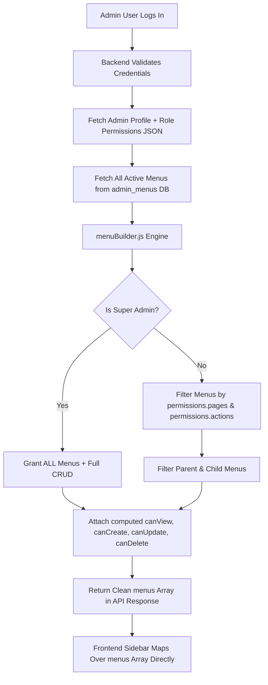

# 🚀 Dynamic RBAC & Database-Driven Menu Architecture
### *A Practical, Production-Ready Guide for Multi-Tenant Role-Based Access Control*

---

## 📌 1. Introduction: Problem Statement & Vision

Jab hum koi Admin Dashboard banate hain, to sabse common galti hoti hai **frontend me hardcoded menus aur `if/else` checks lagana**:
```javascript
// ❌ BAD PRACTICE (Hardcoded & Inflexible)
if (user.role === 'admin') {
  showMenu(['Dashboard', 'Reels', 'Users', 'Settings']);
} else if (user.role === 'moderator') {
  showMenu(['Dashboard', 'Reels']);
}
```

### Is approach me kya problems aati hain?
1. **No Flexibility:** Kal ko naya role chahiye (jaise *Audit Viewer* ya *Senior Manager*), to frontend ka code change karke redeploy karna padega.
2. **Permissions change nahi kar sakte:** Agar Super Admin kisi role ko 1 extra page dena chahe ya kisi user ka access badalna chahe, to code me change kiye bina possible nahi hota.
3. **Multi-Tenant Complexity:** Agar alag-alag clients/tenants hain, to unka data aur menus mix hone ka khatra rehta hai.
4. **Security Risk:** Frontend se menu hide karne par bhi agar backend API secure nahi hai, to koi bhi direct API hit karke data chura sakta hai.

### ✅ The Solution (Our Architecture)
* **Database-Driven Dynamic Menus:** Menus database me rehte hain.
* **Granular JSON Permissions:** Har role ke paas allowed `pages` aur specific `actions` hote hain.
* **Backend Menu Builder:** Login ya profile load par backend user ke role aur permissions ko match karke sirf wahi menus return karta hai jinka user ke paas access hai.
* **Multi-Tenant Isolation:** Super Admin global hota hai, jabki Tenant Admins sirf apne tenant ke data tak limited rehte hain.

---

## 🏗️ 2. High-Level Architecture & Flow



---

## 🗄️ 3. Database Schema Design (3 Core Tables)

Ye architecture 3 simple tables par tiki hui hai:

### Table 1: `admin_menus` (Menu Master)
Har navigation item yahan store hota hai. Self-referencing foreign key (`parent_id`) se submenus handle hote hain.

```sql
CREATE TABLE admin_menus (
  id INT AUTO_INCREMENT PRIMARY KEY,
  label VARCHAR(100) NOT NULL,          -- e.g. "Reels Moderation"
  path VARCHAR(255) NULL,               -- e.g. "/moderation/reels"
  icon VARCHAR(50) NOT NULL,            -- e.g. "reels", "shield", "users"
  page_key VARCHAR(50) NOT NULL,        -- Unique identifier: "moderation", "roles"
  parent_id INT NULL,                   -- Submenu ke liye parent menu ka ID
  order_index INT NOT NULL DEFAULT 0,   -- Display sorting order
  is_active TINYINT(1) DEFAULT 1,
  CONSTRAINT fk_admin_menus_parent FOREIGN KEY (parent_id) 
    REFERENCES admin_menus(id) ON DELETE CASCADE
);
```

### Table 2: `admin_roles` (Dynamic Roles & Permissions)
Yahan roles store hote hain. Sabse critical column hai `permissions` (MySQL JSON type).

```sql
CREATE TABLE admin_roles (
  id INT AUTO_INCREMENT PRIMARY KEY,
  client_id BIGINT NULL,                -- NULL = Global (Super Admin), Number = Tenant-specific
  name VARCHAR(100) NOT NULL,           -- e.g. "Content Admin"
  slug VARCHAR(100) NOT NULL,           -- e.g. "content_admin"
  permissions JSON NOT NULL,            -- Pages + Actions Permissions JSON
  is_system_role TINYINT(1) DEFAULT 0   -- System roles delete nahi ho sakte, edit ho sakte hain
);
```

#### 📄 Example `permissions` JSON Structure:
```json
{
  "pages": ["dashboard", "moderation", "reels", "categories"],
  "actions": {
    "all": false,
    "canApproveReel": true,
    "canRejectReel": true,
    "canSuspendReel": true,
    "canBlockUser": false,
    "canManageCategories": true,
    "canManageAdmins": false,
    "canManageRoles": false,
    "canBulkUploadMusic": false,
    "isReadOnly": false
  }
}
```

### Table 3: `admins` (Users Table)
```sql
CREATE TABLE admins (
  id BIGINT AUTO_INCREMENT PRIMARY KEY,
  username VARCHAR(100) NOT NULL,
  email VARCHAR(150) NOT NULL UNIQUE,
  password_hash VARCHAR(255) NOT NULL,
  role_id INT NOT NULL,                 -- FK to admin_roles.id
  client_id BIGINT NULL,                -- NULL = Global access, Number = Tenant scoped
  is_active TINYINT(1) DEFAULT 1,
  FOREIGN KEY (role_id) REFERENCES admin_roles(id)
);
```

---

## ⚙️ 4. The Core Logic: `menuBuilder.js`

Backend me jab user profile load hota hai (`/api/admin/me` ya `/api/admin/login`), ye function execute hota hai:

```javascript
async function buildAdminMenus(roleSlug, permissions = {}) {
  // 1. Super Admin Check
  const isSuperAdmin =
    roleSlug === "super_admin" ||
    roleSlug === "superadmin" ||
    Boolean(permissions?.actions?.all);

  const allowedPages = Array.isArray(permissions?.pages) ? permissions.pages : ["dashboard"];
  const isReadOnly = Boolean(permissions?.actions?.isReadOnly);
  const actions = permissions?.actions || {};

  // 2. Database se saare active menus fetch karo
  const dbMenus = await AdminMenusRepository.findAllActiveMenus();

  // 3. Parent aur Children separate karo
  const rootMenus = dbMenus.filter((m) => m.parent_id === null);
  const childMenusMap = {};
  for (const m of dbMenus) {
    if (m.parent_id !== null) {
      if (!childMenusMap[m.parent_id]) childMenusMap[m.parent_id] = [];
      childMenusMap[m.parent_id].push(m);
    }
  }

  // 4. Recursive Item Resolver
  function resolveItem(row) {
    const isAll = isSuperAdmin || allowedPages.includes("*");
    const hasAccess =
      isAll ||
      allowedPages.includes(row.page_key) ||
      allowedPages.includes(String(row.id)) ||
      (row.path && allowedPages.includes(row.path.replace(/^\//, "")));

    const childrenRows = childMenusMap[row.id] || [];
    const allowedChildren = childrenRows.map(resolveItem).filter(Boolean);

    // Agar item parent menu hai (jiske submenus hain)
    if (childrenRows.length > 0) {
      // Agar user ke paas kisi bhi child menu ka access hai tabhi parent dikhao
      if (allowedChildren.length > 0 || isAll) {
        return {
          id: String(row.id),
          label: row.label,
          path: row.path,
          icon: row.icon,
          orderIndex: row.order_index,
          permissions: {
            canView: true,
            canCreate: isSuperAdmin || !isReadOnly,
            canUpdate: isSuperAdmin || !isReadOnly,
            canDelete: isSuperAdmin || !isReadOnly,
          },
          children: allowedChildren,
        };
      }
      return null; // Kisi child ka access nahi -> poora parent hide
    }

    // Single menu item check
    if (!hasAccess) {
      return null;
    }

    // Granular CRUD permissions calculate karo
    return {
      id: String(row.id),
      label: row.label,
      path: row.path,
      icon: row.icon,
      orderIndex: row.order_index,
      permissions: {
        canView: true,
        canCreate: isSuperAdmin || (!isReadOnly && Boolean(actions.canManageAdmins || actions.all)),
        canUpdate: isSuperAdmin || (!isReadOnly && Boolean(actions.canManageAdmins || actions.all)),
        canDelete: isSuperAdmin || (!isReadOnly && Boolean(actions.canManageAdmins || actions.all)),
      },
    };
  }

  // Final filtered list return karo
  return rootMenus.map(resolveItem).filter(Boolean);
}
```

---

## 🎨 5. Frontend Simple Rendering (No Complex Logic)

Frontend ko koi if/else likhne ki zaroorat nahi hai. Frontend ko login ya `/api/admin/me` ke response me direct filtered array milta hai:

```json
{
  "admin": {
    "username": "john_moderator",
    "role": "moderator",
    "menus": [
      {
        "id": "1",
        "label": "Overview",
        "path": "/",
        "icon": "dashboard",
        "permissions": { "canView": true, "canCreate": false, "canUpdate": false, "canDelete": false }
      },
      {
        "id": "3",
        "label": "Reels Moderation",
        "path": "/moderation/reels",
        "icon": "reels",
        "permissions": { "canView": true, "canCreate": false, "canUpdate": true, "canDelete": true }
      }
    ]
  }
}
```

### React Sidebar Component Example:
```tsx
export const Sidebar = ({ menus }) => {
  return (
    <aside className="sidebar">
      {menus.map((item) => (
        <div key={item.id}>
          <NavLink to={item.path} className="nav-item">
            <Icon name={item.icon} />
            <span>{item.label}</span>
          </NavLink>
          
          {/* Submenus if present */}
          {item.children && (
            <div className="sub-menu">
              {item.children.map((sub) => (
                <NavLink key={sub.id} to={sub.path}>
                  {sub.label}
                </NavLink>
              ))}
            </div>
          )}
        </div>
      ))}
    </aside>
  );
};
```
👉 **Jo menu user ke access me nahi hai, wo backend se array me aaya hi nahi, isliye frontend par render hi nahi hoga!**

---

## 🔒 6. Multi-Tenant Scoping (`client_id` Isolation)

Aksar question aata hai: **"Agar Tenant Admin ko saare pages ka access de dein, to kya wo doosre clients ka data dekh lega?"**

**Answer: Bilkul nahi!**
Yahan **2-Level Separation** kaam karti hai:

1. **Page Access (Menus):**
   * Tenant admin ko wahi menus dikhte hain jo uske role me hain.
2. **Data Access (Database Queries):**
   * Backend me `enforceTenantScope` middleware har request par lagta hai:
   ```javascript
   function enforceTenantScope(req, res, next) {
     if (req.admin && req.admin.clientId) {
       // Request ke query aur body me client_id forcefully lock kar do
       req.query.client_id = req.admin.clientId;
       if (req.body && typeof req.body === "object") {
         req.body.client_id = req.admin.clientId;
       }
     }
     next();
   }
   ```
   * Chahe Tenant Admin sabhi menus dekh sake, SQL query hamesha `WHERE client_id = ?` ke sath hi execute hogi. Doosre tenant ka data leak hona impossible hai.

---

## 💡 7. Frequently Asked Questions (Friend Ko Samjhane Ke Liye)

### Q1: Kya roles backend me fix / hardcoded hote hain?
> **Answer: Nahi.** 
> System ke 5 initial roles sirf starter templates hain. Super Admin frontend UI se:
> 1. Naya custom role bana sakta hai (`POST /api/admin/roles`).
> 2. Kisi bhi role ke permissions live edit kar sakta hai (`PUT /api/admin/roles/:id`).
> 3. Kisi bhi user ka role change kar sakta hai (`PATCH /api/admin/admin-users/:id/role`).

### Q2: Super Admin ne kisi user ka access badla, to usko turant kaise dikhega?
> **Answer: Reload ya Re-login par.**
> * User ka token JWT hota hai.
> * Jaise hi user browser refresh karega, frontend `/api/admin/me` call karega.
> * Backend database se latest role aur permissions uthakar `menuBuilder` chalaega aur naye menus bhej dega.
> * User ko turant naye menus aur buttons screen par dikhne lagenge!

### Q3: Agar user directly URL type kare (e.g. `/settings/admins`), to kya wo access kar lega?
> **Answer: Nahi, backend route guards block kar denge.**
> Frontend par sirf hide karna security nahi hoti. Backend router par guards lage hain:
> ```javascript
> router.post("/admin/admin-users", 
>   authenticateAdmin, 
>   requireAction("canManageAdmins"), 
>   AdminAuthController.createAdminUser
> );
> ```
> Agar user bina permission ke direct API hit karega, to backend `403 Forbidden` return karega.

---

## 🌟 8. Summary Checklist for Your Friend

| Feature | Kaisi Honi Chahiye? | Kyu? |
|---|---|---|
| **Menu Source** | Database (`admin_menus` table) | Menus dynamically add/remove/reorder ho sakein bina frontend deploy kiye. |
| **Permissions** | JSON column in `admin_roles` (`pages` + `actions`) | Highly granular & customizable (Read vs Write vs Delete). |
| **Menu Filtering** | Backend Engine (`menuBuilder.js`) | Frontend ko zero calculation karni pade, clean array mile. |
| **API Security** | Middleware Guards (`requireAction`, `requireSuperAdmin`) | Direct URL/API abuse se complete protection. |
| **Multi-Tenancy** | Automatic Scope Lock (`enforceTenantScope`) | Har client sirf apne tenant ke data me locked rahe. |

---
*Created for FitShort Platform Technical Documentation & Knowledge Sharing.*
