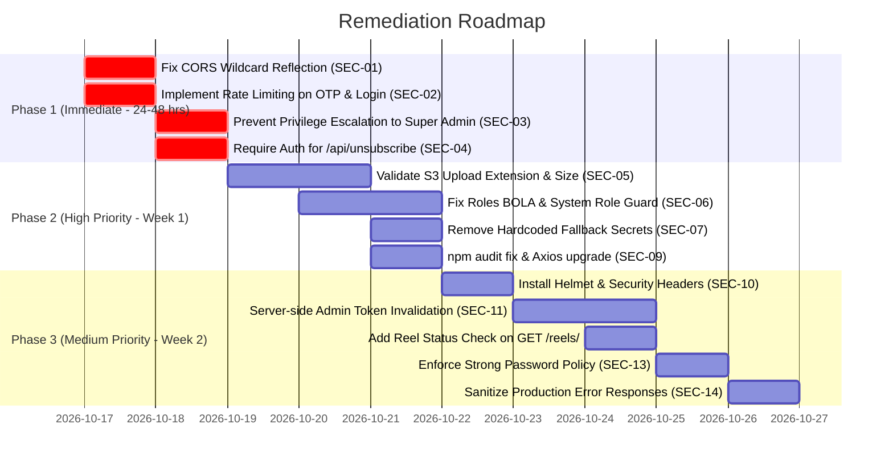

# Security Audit Report — TickHigh FitShort (Wellness360) Backend

**Audit Target:** TickHigh FitShort Backend (`/backend`)  
**Auditor:** Senior Application Security Engineer & Penetration Tester  
**Standard Benchmarks:** OWASP Top 10 (2021), OWASP API Security Top 10 (2023)  
**Date:** October 2026  
**Status:** Complete Audit (No Code Modified — Assessment Only)  

---

## 1. Executive Summary

TickHigh FitShort (Wellness360) backend ka comprehensive source code security review kiya gaya. Codebase me kaafi solid architectural foundations hain jaise:
- Raw queries me **Parameterized Prepared Statements** ka systematically use kiya gaya hai (SQL Injection se bachaav).
- Password aur Refresh Token hashing ke liye **Bcrypt (Salt factor 10)** implement kiya gaya hai.
- Multi-tenant client context (`req.client`) aur Zod schema validation ka use kiya gaya hai.

Lekin, application me **Critical and High severity vulnerabilities** maujood hain jo production deployment me severe risk create karti hain:
1. **Critical CORS Wildcard with Credentials:** Origin reflection ke sath `Access-Control-Allow-Credentials: true` enabled hai (Cross-Origin Data Leakage).
2. **Missing Rate Limiting:** Global aur sensitive endpoints (OTP, login, carrier billing) par koi rate limiter nahi hai (SMS bombing, brute force, financial abuse).
3. **Privilege Escalation & BOLA in Admin Team/Roles:** Ek Client Admin dusre client ke roles ko edit/delete kar sakta hai aur `roleId: 1` (`super_admin`) assign karke khud ya kisi ko Super Admin bana sakta hai.
4. **Arbitrary Unsubscribe Vulnerability:** Kisi bhi subscriber ka phone number bina kisi authentication ya OTP verification ke deactivate/unsubscribe kiya ja sakta hai.
5. **Insecure Presigned S3 Upload:** File extension aur MIME types par koi allowlist ya file-size restriction nahi hai (Malicious file upload / XSS / Resource exhaustion).
6. **Hardcoded Fallback JWT Secrets & Default Admin Passwords:** Hardcoded secrets codebase me paye gaye hain.
7. **Known Vulnerable Dependencies:** `proxy-addr` (Critical - IP spoofing), `axios` (High - Prototype pollution, ReDoS), `braces` (High - DoS).

### Overall Security Score: `5.4 / 10`

| Severity | Count | Summary |
|---|:---:|---|
| **CRITICAL** | 4 | CORS with Credentials reflection, Missing Rate Limiting on SMS/Auth, Privilege Escalation to Super Admin, Arbitrary Unsubscribe without Auth |
| **HIGH** | 5 | Insecure File Extension in S3 Presigned URL, Broken Object-Level Authorization (BOLA) on Roles, Hardcoded JWT Fallback Secret, Plaintext Sensitive Logging, Outdated High/Critical Dependencies |
| **MEDIUM** | 5 | Missing Security Headers (No Helmet/HSTS), Missing Refresh Token Invalidation on Admin Logout, Missing Video Publication Access Control on `GET /api/reels/:id`, Weak Admin Password Policy, Verbose Error Leaks in API Responses |
| **LOW** | 3 | Missing DB TLS/SSL config in connection pool, Missing HTTP Timeout / Slowloris mitigations, Redundant route mounting in `src/routes/index.js` |
| **TOTAL** | **17** | **Active Findings Requiring Remediation** |

---

## 2. Findings Table

| ID | Severity | Category | File:Line | Issue Description | Impact |
|---|---|---|---|---|---|
| **SEC-01** | **CRITICAL** | Security Headers & Network | `src/app.js:14-16` | Wildcard Origin Reflection with `Allow-Credentials: true` | Kisi bhi malicious website se authenticated user/admin ka data chori ho sakta hai |
| **SEC-02** | **CRITICAL** | Rate Limiting & Abuse | Global (`src/app.js`, `src/modules/otp/*`, `src/modules/admin/auth/*`) | Rate Limiting bilkul absent hai | SMS bombing, telecom balance drain, OTP aur password brute-force attack |
| **SEC-03** | **CRITICAL** | Authorization & Access Control | `src/modules/admin/auth/adminAuth.service.js:192-226` | Privilege Escalation to Super Admin by Client Admin | Normal admin role user `super_admin` ban sakta hai aur poora platform hijack kar sakta hai |
| **SEC-04** | **CRITICAL** | Authorization & Business Logic | `src/modules/authOtp/authOtp.router.js:8` | Unauthenticated Arbitrary Unsubscribe (`/api/unsubscribe`) | Koi bhi attacker kisi bhi user ka number bhej kar uski subscription cancel karwa sakta hai |
| **SEC-05** | **HIGH** | File Upload Security | `src/modules/reels/reels.controller.js:5-10`, `src/integrations/s3/s3.client.js:15-28` | S3 Presigned Upload URL me file extension aur size ka validation nahi hai | Executable (.exe), HTML, SVG script upload aur 100GB file se storage exhaustion |
| **SEC-06** | **HIGH** | Authorization (BOLA/IDOR) | `src/modules/admin/roles/adminRoles.service.js:71-128` | Roles CRUD me Client Tenant Scoping verify nahi hoti | Ek client ka admin dusre client ke custom roles ko delete/modify kar sakta hai |
| **SEC-07** | **HIGH** | Secrets & Configuration | `src/config/jwt.config.js:7` | Hardcoded Fallback Secret string for Admin Refresh JWT | Agar env variable set na ho to koi bhi admin refresh token forge kar sakta hai |
| **SEC-08** | **HIGH** | Error Handling & Logging | `src/utils/telecomLogger.js:80-99` | Plaintext telecom logs me MSISDN, cURL aur tokens local disk par save ho rahe hain | Server compromise par subscriber PII aur tokens leak ho sakte hain |
| **SEC-09** | **HIGH** | Supply Chain / Dependencies | `package.json:20`, `package-lock.json` | 10 known vulnerabilities (`proxy-addr`, `axios`, `brace-expansion`, etc.) | Prototype pollution, IP spoofing, DoS attack |
| **SEC-10** | **MEDIUM** | Security Headers | `src/app.js` | Helmet middleware missing (No HSTS, No CSP, No X-Frame-Options) | Clickjacking, MIME-sniffing, man-in-the-middle downgrade attack |
| **SEC-11** | **MEDIUM** | Authentication & Session | `src/modules/admin/auth/adminAuth.controller.js:65-69` | Admin Logout par server-side refresh token invalidation nahi hai | Stolen admin refresh token 7 din tak valid rehta hai |
| **SEC-12** | **MEDIUM** | Authorization & Data Exposure | `src/modules/reels/reels.repository.js:22-29`, `src/modules/reels/reels.service.js:166-207` | `GET /api/reels/:id` me reel status (`published`) check nahi hota | Koi bhi user kisi aur ka `rejected` ya `pending_review` video signed URL nikaal kar dekh sakta hai |
| **SEC-13** | **MEDIUM** | Authentication | `src/validations/admin.validation.js:24-34` | Admin Password Policy bohot weak hai (min 6 characters, no complexity) | Dictionary / brute-force attacks se weak password crack ho sakte hain |
| **SEC-14** | **MEDIUM** | Error Handling | `src/app.js:61-64` & Controllers | `err.message` directly client ko return hota hai | Internal database error, SQL syntax ya file path user ko expose ho sakta hai |
| **SEC-15** | **LOW** | Database Security | `src/config/db.config.js:4-11` | MySQL connection pool me TLS/SSL option enforce nahi hai | Network sniffing se database credentials aur data plaintext me ja sakta hai |
| **SEC-16** | **LOW** | DoS & Network Security | `src/app.js` | HTTP Server timeouts (Slowloris protection) set nahi hain | Slow HTTP requests se server connections exhaust ho sakte hain |
| **SEC-17** | **LOW** | Code Hygiene / Routing | `src/routes/index.js:15-22` | Duplicate route mounting (`subscriptionRoutes`, `authOtp`) | Unnecessary route traversal and potential unintended route triggers |

---

## 3. Detailed Findings (Har Issue ki Deep Explanation aur Fix)

---

### SEC-01: Wildcard Origin Reflection with Credentials in CORS
- **Severity:** `CRITICAL` (CVSS 9.1)
- **OWASP Category:** A05:2021 – Security Misconfiguration / OWASP API7:2023 – Server-Side Request Forgery
- **Location:** [src/app.js:13-28](file:///Users/Aryan/Documents/Aryan/Project/tickhigh-fitshort/backend/src/app.js#L13-L28)

#### Kya problem hai (Simple Language me):
CORS (Cross-Origin Resource Sharing) browser ka ek security feature hai jo ye decide karta hai ki kaun si website aapke backend se data maang sakti hai. `src/app.js` me line 14 par likha hai:
`const origin = req.headers.origin || "*";` aur fir `res.setHeader("Access-Control-Allow-Origin", origin)` ke sath `Access-Control-Allow-Credentials: "true"` set kiya hai.
Iska matlab internet par maujood **KOI BHI WEBSITE** (jaise `evil-hacker.com`) agar user ke browser me open ho, to wo user ya admin ke cookies aur tokens ke sath aapke backend par request bhej sakti hai aur private data read kar sakti hai!

#### Attacker kaise exploit karega:
1. Ek subscriber ya Super Admin apne browser me Admin Portal ya app par logged-in hai (unke browser me `refreshToken` ya session active hai).
2. Attacker unhe ek phishing link bhejta hai (`https://attacker-site.com`).
3. Attacker ki website background me JavaScript chala kar `fetch('http://api.fitshort.com/api/me', { credentials: 'include' })` call karegi.
4. Backend `Access-Control-Allow-Origin: https://attacker-site.com` return karega, jisse browser attacker ki script ko admin/user ka poora data read karne dega.

#### Vulnerable Code Snippet:
```javascript
// src/app.js:13-17
app.use((req, res, next) => {
  const origin = req.headers.origin || "*";
  res.setHeader("Access-Control-Allow-Origin", origin);
  res.setHeader("Access-Control-Allow-Credentials", "true");
```

#### Fix Kaise Karein (Secure Code):
Allowed domains ki ek strict allowlist banao:
```javascript
// src/app.js FIX:
const ALLOWED_ORIGINS = [
  "http://localhost:3000",
  "http://localhost:5173",
  "https://fitshort.tickhighs.com",
  "https://admin.tickhighs.com"
];

app.use((req, res, next) => {
  const origin = req.headers.origin;
  if (ALLOWED_ORIGINS.includes(origin)) {
    res.setHeader("Access-Control-Allow-Origin", origin);
    res.setHeader("Access-Control-Allow-Credentials", "true");
  } else if (!origin) {
    // Mobile apps ya server-to-server calls me origin header nahi hota
    res.setHeader("Access-Control-Allow-Origin", "");
  }

  res.setHeader(
    "Access-Control-Allow-Headers",
    "Origin, X-Requested-With, Content-Type, Accept, Authorization, x-tenant-id, x-client-subdomain"
  );
  res.setHeader("Access-Control-Allow-Methods", "GET, POST, PUT, PATCH, DELETE, OPTIONS");

  if (req.method === "OPTIONS") {
    return res.status(200).end();
  }
  next();
});
```

---

### SEC-02: Rate Limiting & Abuse Protection Bilkul Absent Hai
- **Severity:** `CRITICAL` (CVSS 9.3)
- **OWASP Category:** A04:2021 – Insecure Design / OWASP API4:2023 – Unrestricted Resource Consumption
- **Location:** [src/app.js](file:///Users/Aryan/Documents/Aryan/Project/tickhigh-fitshort/backend/src/app.js), [src/modules/otp/otp.routes.js](file:///Users/Aryan/Documents/Aryan/Project/tickhigh-fitshort/backend/src/modules/otp/otp.routes.js), [src/modules/authOtp/authOtp.router.js](file:///Users/Aryan/Documents/Aryan/Project/tickhigh-fitshort/backend/src/modules/authOtp/authOtp.router.js), [src/modules/admin/admin.router.js](file:///Users/Aryan/Documents/Aryan/Project/tickhigh-fitshort/backend/src/modules/admin/admin.router.js)

#### Kya problem hai (Simple Language me):
Pure backend codebase me kahi bhi `express-rate-limit` ya Redis-based rate limiter use nahi hua hai.
Iska matlab:
1. **SMS / OTP Bombing:** Attacker `/api/otp/send` aur `/api/auth-otp/send` ko loop me 10,000 baar call kar sakta hai. Har request par third-party telecom operator ko SMS charge lagega, jisse company ko massive financial loss hoga aur telecom gateway block ho sakta hai.
2. **OTP Brute Force:** SMS OTP 4 ya 6 digits ka hota hai (`10,000` ya `1,000,000` combinations). Bina rate limit ke attacker 1 minute me script chala kar saare combination try karke kisi ka bhi account login kar sakta hai.
3. **Admin Login Brute Force:** `/api/admin/login` par koi attempt limit ya account lockout nahi hai. Attacker dictionary attack se password crack kar sakta hai.

#### Attacker kaise exploit karega:
```bash
# OTP Brute force attack example (1000 requests per second)
for otp in {0000..9999}; do
  curl -s -X POST http://localhost:3000/api/otp/verify \
    -H "Content-Type: application/json" \
    -d "{\"msisdn\":\"22674031858\",\"otp\":\"$otp\"}" | grep -q '"success":true' && echo "Found: $otp" &
done
```

#### Fix Kaise Karein (Secure Code):
`express-rate-limit` install karein (`npm install express-rate-limit`):
```javascript
// src/middlewares/rateLimiter.middleware.js
const rateLimit = require("express-rate-limit");
const apiResponse = require("../utils/apiResponse");

// 1. Global general limiter (100 requests per 15 minutes per IP)
const globalLimiter = rateLimit({
  windowMs: 15 * 60 * 1000,
  max: 300,
  message: { success: false, status: 429, message: "Too many requests. Please try again later." }
});

// 2. Strict OTP limiter (3 OTP send requests per 5 minutes per MSISDN/IP)
const otpSendLimiter = rateLimit({
  windowMs: 5 * 60 * 1000,
  max: 3,
  message: { success: false, status: 429, message: "Too many OTP requests. Please wait 5 minutes." }
});

// 3. Strict OTP Verify limiter (5 verification attempts per 10 minutes)
const otpVerifyLimiter = rateLimit({
  windowMs: 10 * 60 * 1000,
  max: 5,
  message: { success: false, status: 429, message: "Too many incorrect OTP attempts. Account locked temporarily." }
});

// 4. Admin Login limiter (5 login attempts per 15 minutes)
const adminLoginLimiter = rateLimit({
  windowMs: 15 * 60 * 1000,
  max: 5,
  message: { success: false, status: 429, message: "Too many failed admin login attempts. Please try again after 15 minutes." }
});

module.exports = {
  globalLimiter,
  otpSendLimiter,
  otpVerifyLimiter,
  adminLoginLimiter,
};
```
Isse `app.js`, `otp.routes.js`, aur `admin.router.js` ke respective routes par lagao.

---

### SEC-03: Privilege Escalation to Super Admin by Client Admin
- **Severity:** `CRITICAL` (CVSS 9.8)
- **OWASP Category:** A01:2021 – Broken Access Control / OWASP API1:2023 – Broken Object Level Authorization
- **Location:** [src/modules/admin/auth/adminAuth.service.js:192-226](file:///Users/Aryan/Documents/Aryan/Project/tickhigh-fitshort/backend/src/modules/admin/auth/adminAuth.service.js#L192-L226)

#### Kya problem hai (Simple Language me):
Ek Client Admin (jaise Orange Burkina Faso ka admin jiske paas `canManageAdmins` permission hai) jab naya admin create karta hai (`POST /api/admin/admin-users`), to wo request body me `roleId: 1` (`super_admin`) bhej sakta hai.
Backend code me sirf `finalClientId` ko lock kiya gaya hai, lekin **ye check hi nahi kiya gaya ki kya naya admin `super_admin` banaya ja raha hai aur kya request karne wala khud Super Admin hai ya nahi!**
Nateeja: Ek client-level ka admin naya account bana kar poore platform ka Super Admin ban sakta hai aur sabhi clients ka data access kar sakta hai.

#### Vulnerable Code Snippet:
```javascript
// src/modules/admin/auth/adminAuth.service.js:192-216
  // Determine Role & Role ID
  let assignedRoleId = roleId;
  let assignedRoleSlug = roleSlug;

  if (assignedRoleId) {
    const roleObj = await AdminRolesRepository.findRoleById(assignedRoleId);
    if (roleObj) {
      assignedRoleSlug = roleObj.slug;
    }
  }

  // Tenant scoping: Sirf clientId ko lock kiya, role ko check hi nahi kiya!
  const finalClientId = creatorClientId ? creatorClientId : (clientId || null);
```

#### Attacker kaise exploit karega:
Client Admin `POST /api/admin/admin-users` request karta hai:
```json
{
  "email": "rogue@hacker.com",
  "password": "Password123!",
  "roleId": 1
}
```
System `roleId: 1` dekh kar role ko `super_admin` set kar dega. Phir [checkPermission.js:15](file:///Users/Aryan/Documents/Aryan/Project/tickhigh-fitshort/backend/src/middlewares/checkPermission.js#L15) par likha hai:
```javascript
if (admin.role === "super_admin") {
  return next(); // Super Admin bypasses ALL checks!
}
```
Ab wo attacker account bina kisi restriction ke har tenant ka data read/delete kar sakta hai!

#### Fix Kaise Karein (Secure Code):
```javascript
// src/modules/admin/auth/adminAuth.service.js FIX:
  // Role verification guard:
  if (assignedRoleSlug === "super_admin" || Number(assignedRoleId) === 1) {
    // Sirf wahi admin super_admin create kar sakta hai jo KHUD super_admin ho
    if (creatorClientId !== null) {
      throw new Error("Access Denied: Only platform Super Admins can assign or create Super Admin roles.");
    }
  }

  // Same check updateAdminUserRole function me bhi lagayein!
```

---

### SEC-04: Unauthenticated Arbitrary Unsubscribe (`/api/unsubscribe`)
- **Severity:** `CRITICAL` (CVSS 8.6)
- **OWASP Category:** A01:2021 – Broken Access Control / OWASP API1:2023 – Broken Object Level Authorization
- **Location:** [src/modules/authOtp/authOtp.router.js:8](file:///Users/Aryan/Documents/Aryan/Project/tickhigh-fitshort/backend/src/modules/authOtp/authOtp.router.js#L8)

#### Kya problem hai (Simple Language me):
Endpoint `POST /api/unsubscribe` bina kisi authentication ke khula hua hai. Koi bhi person kisi doosre subscriber ka MSISDN (phone number) bhej kar use telecom service se unsubscribe karwa sakta hai.
Koi token check nahi hai, koi OTP confirmation nahi hai.
Iska matlab ek competitor ya malicious script poore database ke valid paid users ko ek simple script chala kar unsubscribe kar sakti hai (Denial of Service on revenue and user subscriptions).

#### Vulnerable Code Snippet:
```javascript
// src/modules/authOtp/authOtp.router.js:8
router.post("/unsubscribe", validate(sendOtpSchema), authOtpController.UnsubscribeUser);
```

#### Attacker kaise exploit karega:
Attacker ek simple Python ya Bash loop chala kar random ya scraped numbers bhejta hai:
```bash
curl -X POST http://localhost:3000/api/unsubscribe \
  -H "Content-Type: application/json" \
  -H "x-client-subdomain: obf" \
  -d '{"msisdn": "22674031858"}'
```
Backend immediately telecom gateway ko call karke user ka subscription cancel kar dega aur local DB me `user_subscriptions` aur `user_client_relations` ko deactivate kar dega!

#### Fix Kaise Karein (Secure Code):
Unsubscribe request hamesha **authenticated user** dwara honi chahiye, ya fir unsubscribe karne se pehle OTP verify karwana zaroori hona chahiye:
```javascript
// Option 1: Authenticated User Only (Recommended)
const authenticateUser = require("../../middlewares/auth.middlewares");
router.post("/unsubscribe", authenticateUser, authOtpController.UnsubscribeUser);

// Controller me req.body.msisdn ki jagah authenticated user ka number use karein:
async function UnsubscribeUser(req, res) {
  const userId = req.user.userId;
  const user = await usersRepository.findById(userId);
  const result = await authOtpService.unsubscribeUser(user.msisdn, req.client?.id);
  return apiResponse(res, 200, "Unsubscribed successfully", result);
}
```

---

### SEC-05: Insecure File Extension & Missing Size Limit on Presigned S3 URLs
- **Severity:** `HIGH` (CVSS 8.2)
- **OWASP Category:** A04:2021 – Insecure Design / OWASP API4:2023 – Unrestricted Resource Consumption
- **Location:** [src/modules/reels/reels.controller.js:4-17](file:///Users/Aryan/Documents/Aryan/Project/tickhigh-fitshort/backend/src/modules/reels/reels.controller.js#L4-L17), [src/integrations/s3/s3.client.js:15-28](file:///Users/Aryan/Documents/Aryan/Project/tickhigh-fitshort/backend/src/integrations/s3/s3.client.js#L15-L28)

#### Kya problem hai (Simple Language me):
Jab user reel video upload karne ke liye S3 upload URL maangta hai (`GET /api/reels/upload-url?fileExtension=...`), to backend `fileExtension` ko bina kisi validation ke accept kar leta hai.
1. Koi extension allowlist nahi hai (user `.html`, `.svg`, `.exe`, `.sh` daal sakta hai).
2. S3 command me `ContentLength` ya max size policy nahi hai, jisse koi user 50 GB ki file upload karke aapka AWS bill aur disk space khatam kar sakta hai.
3. User jab reel save karta hai (`POST /api/reels`), to wo `rawS3Key` manually body me bhejta hai. Backend ye verify nahi karta ki wo `rawS3Key` usi user ke folder ka hai ya nahi!

#### Vulnerable Code Snippet:
```javascript
// src/integrations/s3/s3.client.js:15-22
async function generateUploadUrl(userId, fileExtension, clientId = 1) {
  const key = `clients/client_${clientId}/uploads/${userId}/${uuidv4()}.${fileExtension}`;

  const command = new PutObjectCommand({
    Bucket: s3Config.bucketName,
    Key: key,
    ContentType: `video/${fileExtension}`, // Koi validation nahi!
  });
```

#### Fix Kaise Karein (Secure Code):
```javascript
// src/validations/reels.validation.js
const ALLOWED_VIDEO_EXTENSIONS = ["mp4", "mov", "webm", "m4v"];

// reels.controller.js FIX:
async function getUploadUrl(req, res) {
  const { fileExtension } = req.query;
  const cleanExt = String(fileExtension || "").toLowerCase().replace(/[^a-z0-9]/g, "");

  if (!ALLOWED_VIDEO_EXTENSIONS.includes(cleanExt)) {
    return apiResponse(res, 400, "Invalid file extension. Allowed formats: mp4, mov, webm, m4v");
  }

  const userId = req.user.userId;
  const clientId = req.client ? req.client.id : 1;
  const result = await ReelService.getUploadUrl(userId, cleanExt, clientId);
  return apiResponse(res, 200, "Upload URL generated", result);
}
```

---

### SEC-06: Broken Object-Level Authorization (BOLA) on Roles CRUD
- **Severity:** `HIGH` (CVSS 8.5)
- **OWASP Category:** A01:2021 – Broken Access Control / OWASP API1:2023 – Broken Object Level Authorization
- **Location:** [src/modules/admin/roles/adminRoles.service.js:71-128](file:///Users/Aryan/Documents/Aryan/Project/tickhigh-fitshort/backend/src/modules/admin/roles/adminRoles.service.js#L71-L128)

#### Kya problem hai (Simple Language me):
Roles update karne (`PUT /api/admin/roles/:id`) aur delete karne (`DELETE /api/admin/roles/:id`) ke function me check hi nahi kiya gaya ki kya target role usi client ka hai jiska logged-in admin hai.
Iske alawa:
Line 79 par likha hai: `name: role.is_system_role ? role.name : (name || role.name)`, lekin `permissions: permissions !== undefined ? permissions : role.permissions`.
Iska matlab koi bhi Client Admin jiske paas role manage karne ki permission ho, wo **SYSTEM ROLES (Super Admin, Moderator etc.) ke permissions JSON ko modify karke poore platform ka system compromise kar sakta hai!**

#### Fix Kaise Karein (Secure Code):
```javascript
// src/modules/admin/roles/adminRoles.service.js FIX:
async function updateExistingRole(id, { name, description, permissions }, adminId, adminUsername, ipAddress, clientScope = null) {
  const role = await AdminRolesRepository.findRoleById(id);
  if (!role) {
    throw new Error("Role not found");
  }

  // 1. System roles can only be edited by Super Admin (clientScope === null)
  if (role.is_system_role && clientScope !== null) {
    throw new Error("Access Denied: System standard roles can only be modified by Super Admins.");
  }

  // 2. Tenant isolation check: Client Admin can only edit roles belonging to their client
  if (clientScope !== null && role.client_id !== Number(clientScope)) {
    throw new Error("Access Denied: You do not have permission to modify roles belonging to another tenant.");
  }
  // ... continue update
}
```

---

### SEC-07: Hardcoded Fallback Secret for Admin Refresh Tokens
- **Severity:** `HIGH` (CVSS 7.8)
- **OWASP Category:** A07:2021 – Identification and Authentication Failures / OWASP API2:2023 – Broken Authentication
- **Location:** [src/config/jwt.config.js:7](file:///Users/Aryan/Documents/Aryan/Project/tickhigh-fitshort/backend/src/config/jwt.config.js#L7)

#### Kya problem hai (Simple Language me):
`src/config/jwt.config.js` me line 7 par likha hai:
`adminRefreshSecret: process.env.JWT_ADMIN_REFRESH_SECRET || process.env.JWT_REFRESH_SECRET || "admin_refresh_secret_998877665544332211"`
Agar kisi environment me ye environment variable miss ho jata hai ya server start me load nahi hota, to backend is hardcoded string ko secret ki tarah use karega.
Kyunki ye code open/shared hai, koi bhi attacker is string se valid admin refresh tokens khud generate (sign) kar lega aur Super Admin account me ghus jayega.

#### Fix Kaise Karein (Secure Code):
Hardcoded fallback hatao aur startup par crash/throw karvao agar secret missing ho:
```javascript
// src/config/jwt.config.js FIX:
if (!process.env.JWT_ADMIN_REFRESH_SECRET && !process.env.JWT_REFRESH_SECRET) {
  throw new Error("FATAL CONFIG ERROR: JWT_ADMIN_REFRESH_SECRET must be defined in environment variables!");
}

module.exports = {
  accessSecret: process.env.JWT_ACCESS_SECRET,
  refreshSecret: process.env.JWT_REFRESH_SECRET,
  adminAccessSecret: process.env.JWT_ADMIN_ACCESS_SECRET,
  adminRefreshSecret: process.env.JWT_ADMIN_REFRESH_SECRET || process.env.JWT_REFRESH_SECRET,
  accessExpiry: "15m",
  refreshExpiry: "30d",
  adminAccessExpiry: "30m",
  adminRefreshExpiry: "7d",
};
```

---

### SEC-08: Plaintext Logging of PII and Sensitive Telecom Tokens to Disk
- **Severity:** `HIGH` (CVSS 7.2)
- **OWASP Category:** A09:2021 – Security Logging and Monitoring Failures
- **Location:** [src/utils/telecomLogger.js:80-150](file:///Users/Aryan/Documents/Aryan/Project/tickhigh-fitshort/backend/src/utils/telecomLogger.js#L80-L150)

#### Kya problem hai (Simple Language me):
`telecomLogger.js` har operator request aur response ko plain text format me `logs/telecom/<subdomain>/<date>.log` aur `logs/telecom/all/<date>.log` me likhta hai.
Isme:
- Pura cURL command likha jata hai (jisme API keys, auth headers shaamil hain).
- Pura response payload likha jata hai (jisme subscriber ka MSISDN, OTP, carrier transaction tokens shamil hain).
Agar server par koi unauthorized access ho jaye ya log file unintentionally expose ho jaye, to complete user PII aur credentials leak ho jayenge.

#### Fix Kaise Karein (Secure Code):
Logger me sensitive fields sanitize/mask karne ka function add karein:
```javascript
function maskSensitiveData(str) {
  if (!str) return str;
  return str
    .replace(/(pin|otp|password|secret|token)=([^& \n\r]+)/gi, "$1=******")
    .replace(/"(pin|otp|password|secret|token)":\s*"[^"]+"/gi, '"$1": "******"');
}
```

---

### SEC-09: Known Vulnerable Packages (1 Critical, 5 High)
- **Severity:** `HIGH` (CVSS 8.8)
- **OWASP Category:** A06:2021 – Vulnerable and Outdated Components
- **Location:** `backend/package.json`, `backend/package-lock.json`

#### Kya problem hai (Simple Language me):
`npm audit` run karne par 10 vulnerabilities mili hain:
1. `proxy-addr` (Critical): IP spoofing vulnerability via IPv4-mapped IPv6 trust subnet. Express me `req.ip` galat calculate ho sakti hai, jisse attacker rate limiters aur IP-based audit logs ko bypass kar sakta hai.
2. `axios` 1.18.1 (High): Prototype pollution gadget, ReDoS in data URIs, Header injection, DoS in HTTP/2.
3. `braces` / `brace-expansion` (High): ReDoS / Stack exhaustion crash.
4. `mysql2` <=3.23.0 (Moderate): Unbounded zlib inflate DoS.

#### Fix Kaise Karein:
```bash
cd backend
npm audit fix
# Axios ko manually update karein:
npm install axios@^1.7.9
```

---

### SEC-10: Missing HTTP Security Headers (No Helmet / HSTS / CSP)
- **Severity:** `MEDIUM` (CVSS 6.5)
- **OWASP Category:** A05:2021 – Security Misconfiguration
- **Location:** [src/app.js](file:///Users/Aryan/Documents/Aryan/Project/tickhigh-fitshort/backend/src/app.js)

#### Kya problem hai (Simple Language me):
Backend me `helmet` package install nahi hai.
Browser ko response bhejte waqt standard security headers missing hain:
- `Strict-Transport-Security` (HSTS): HTTP ko HTTPS me enforce nahi karta.
- `X-Content-Type-Options: nosniff`: Browser ko MIME sniffing karne deta hai.
- `X-Frame-Options: DENY`: Website ko iframe me embed karne se nahi rokta (Clickjacking risk).
- `Content-Security-Policy` (CSP): Missing.

#### Fix Kaise Karein (Secure Code):
`npm install helmet`
```javascript
// src/app.js me top par add karein:
const helmet = require("helmet");
app.use(helmet());
```

---

### SEC-11: Admin Logout Does Not Invalidate Refresh Token on Server
- **Severity:** `MEDIUM` (CVSS 6.1)
- **OWASP Category:** A07:2021 – Identification and Authentication Failures
- **Location:** [src/modules/admin/auth/adminAuth.controller.js:65-69](file:///Users/Aryan/Documents/Aryan/Project/tickhigh-fitshort/backend/src/modules/admin/auth/adminAuth.controller.js#L65-L69)

#### Kya problem hai (Simple Language me):
User logout me to database se tokens delete kiye jaate hain, lekin Admin logout me:
```javascript
async function logout(req, res) {
  res.clearCookie("adminRefreshToken");
  res.clearCookie("refreshToken");
  return apiResponse(res, 200, "Logged out successfully", null);
}
```
Sirf client browser se cookies clear kiye jaate hain! Server-side par token store hi nahi hai, aur koi revocation / blacklist list nahi hai.
Agar kisi attacker ne admin ka refresh token pehle se intercept kar liya ho, to admin ke logout karne ke baad bhi wo token agle 7 dino tak valid rahega aur attacker naye access tokens nikaal sakta hai!

#### Fix Kaise Karein:
Redis me revoked admin tokens ko blacklist karein, ya admin refresh tokens ke liye bhi `admin_refresh_tokens` table banayein:
```javascript
// Logout par Redis me token ko uski remaining TTL tak blacklist karein:
await redis.setex(`bl_${token}`, remainingSeconds, "1");
```

---

### SEC-12: `GET /api/reels/:id` Lacks Publication Status Check
- **Severity:** `MEDIUM` (CVSS 5.3)
- **OWASP Category:** A01:2021 – Broken Access Control
- **Location:** [src/modules/reels/reels.repository.js:22-29](file:///Users/Aryan/Documents/Aryan/Project/tickhigh-fitshort/backend/src/modules/reels/reels.repository.js#L22-L29), [src/modules/reels/reels.service.js:166-207](file:///Users/Aryan/Documents/Aryan/Project/tickhigh-fitshort/backend/src/modules/reels/reels.service.js#L166-L207)

#### Kya problem hai (Simple Language me):
Jab end-user feed dekhta hai, to system sirf `published` aur `approved` reels return karta hai.
Lekin agar koi user direct endpoint `GET /api/reels/:id` par kisi bhi ID ko bhejta hai (e.g. `/api/reels/10`), to query chalti hai:
`SELECT * FROM reels WHERE id = ? AND client_id = ?`
Yahan par `status` check nahi hota!
Iska matlab agar reel `pending_review` me hai, `rejected` hai, ya `suspended` hai, tab bhi backend us video ka **signed S3 streaming URL** generate karke user ko de deta hai. User kisi ka bhi private ya rejected content ID guessing (enumeration) se dekh sakta hai.

#### Fix Kaise Karein:
```javascript
// src/modules/reels/reels.service.js FIX:
async function getReelById(id, clientId = 1, requestingUserId = null) {
  const reel = await ReelsRepository.findReelById(id, clientId);
  if (!reel) {
    throw new Error("Reel not found");
  }

  // Sirf published reels sabke liye open honi chahiye; unapproved reels sirf creator dekh sake:
  const isCreator = requestingUserId && Number(reel.user_id) === Number(requestingUserId);
  const isLive = reel.status === "published" || reel.status === "approved";

  if (!isLive && !isCreator) {
    throw new Error("Reel is currently not available or pending moderation");
  }
  // ... continue signing S3 URL
}
```

---

### SEC-13: Weak Admin Password Policy
- **Severity:** `MEDIUM` (CVSS 5.5)
- **OWASP Category:** A07:2021 – Identification and Authentication Failures
- **Location:** [src/validations/admin.validation.js:24-34](file:///Users/Aryan/Documents/Aryan/Project/tickhigh-fitshort/backend/src/validations/admin.validation.js#L24-L34)

#### Kya problem hai (Simple Language me):
Naye admin user registration ya change password me password validation rule sirf `min(6)` characters hai:
`password: z.string().min(6, "password must be at least 6 characters")`
Admin accounts ke liye koi complexity check nahi hai (na uppercase, na numbers, na special characters). Is wajah se `123456` ya `qwerty` jaisa password ban sakta hai jise seconds me brute-force kiya ja sakta hai.

#### Fix Kaise Karein:
```javascript
// src/validations/admin.validation.js FIX:
const passwordSchema = z
  .string({ required_error: "password is required" })
  .min(10, "Password must be at least 10 characters long")
  .regex(/[A-Z]/, "Password must contain at least one uppercase letter")
  .regex(/[a-z]/, "Password must contain at least one lowercase letter")
  .regex(/[0-9]/, "Password must contain at least one number")
  .regex(/[^A-Za-z0-9]/, "Password must contain at least one special character");
```

---

### SEC-14: Internal Database Error Messages Leaked to API Clients
- **Severity:** `MEDIUM` (CVSS 5.0)
- **OWASP Category:** A05:2021 – Security Misconfiguration
- **Location:** [src/app.js:56-65](file:///Users/Aryan/Documents/Aryan/Project/tickhigh-fitshort/backend/src/app.js#L56-L65) and Controller catch blocks

#### Kya problem hai (Simple Language me):
Global error handler aur feature controllers me error hone par `err.message` directly JSON me bhej diya jata hai:
`message: err.message || "Internal Server Error"`
Agar SQL error, syntax error, ya internal library crash hota hai, to user ko table ke naam, SQL query, database version ya server path dikh jata hai. Ye information attacker ko SQL Injection ya specific CVE exploit karne me madad karti hai.

#### Fix Kaise Karein:
Production environment me generic safe error messages return karein:
```javascript
// src/app.js FIX:
app.use((err, req, res, next) => {
  console.error("[Global Error Handler]:", err);
  const isProd = process.env.NODE_ENV === "production";

  res.status(err.status || 500).json({
    success: false,
    message: isProd && (!err.status || err.status === 500) 
      ? "An unexpected error occurred. Please try again later." 
      : err.message
  });
});
```

---

### SEC-15: MySQL Connection Pool Lacks TLS/SSL Encryption
- **Severity:** `LOW` (CVSS 3.7)
- **OWASP Category:** A02:2021 – Cryptographic Failures
- **Location:** [src/config/db.config.js:4-11](file:///Users/Aryan/Documents/Aryan/Project/tickhigh-fitshort/backend/src/config/db.config.js#L4-L11)

#### Kya problem hai:
Database pool configuration me `ssl` parameter configure nahi hai. Agar database kisi alag host/cloud par run ho raha ho, to plaintext network traffic me database queries intercept ho sakti hain.
#### Fix:
Production config me `ssl: { rejectUnauthorized: true }` enable karein.

---

### SEC-16: Missing Slowloris & HTTP Timeout Protection
- **Severity:** `LOW` (CVSS 3.7)
- **OWASP Category:** A04:2021 – Insecure Design
- **Location:** [src/app.js:68-84](file:///Users/Aryan/Documents/Aryan/Project/tickhigh-fitshort/backend/src/app.js#L68-L84)

#### Kya problem hai:
Express HTTP server par explicit request timeout, headers timeout aur keep-alive timeout set nahi hain. Slow HTTP attacks se server ke socket descriptors block ho sakte hain.
#### Fix:
```javascript
const server = app.listen(port, () => ...);
server.headersTimeout = 20000; // 20s
server.requestTimeout = 30000; // 30s
server.keepAliveTimeout = 65000;
```

---

### SEC-17: Duplicate Route Mounting in `src/routes/index.js`
- **Severity:** `LOW` (Quality/Hygiene)
- **Location:** [src/routes/index.js:15-22](file:///Users/Aryan/Documents/Aryan/Project/tickhigh-fitshort/backend/src/routes/index.js#L15-L22)

#### Kya problem hai:
`subscriptionRoutes` do baar mount kiya gaya hai, aur `authOtp` router teen baar (`authOtp`, `authOtpVerify`, `unsubscribe`) mount kiya gaya hai. Isse duplicate routing overhead hota hai.
#### Fix:
Duplicate calls remove karein.

---

## 4. Checklist Summary Table (Har Point ka Status)

| No. | Audit Area | Sub-Check | Status | Code Evidence & Reasoning |
|:---:|---|---|:---:|---|
| **1** | **Rate Limiting & Abuse** | Global rate limiting | **FAIL** | Koi global rate limiter middleware nahi hai. |
| | | Sensitive endpoints strict rate limit | **FAIL** | Login, OTP verify, OTP send routes open to spam. |
| | | Brute-force protection (lockout/delay) | **FAIL** | Unlimited password & OTP guesses allowed. |
| | | Request body/file size & pagination limits | **PARTIAL** | Pagination limit `Math.min(100)` hai, par S3 upload me size limit policy missing hai. |
| | | Slowloris / DoS timeout protection | **FAIL** | No HTTP server timeout configured. |
| **2** | **Authentication** | Password hashing (bcrypt / argon2) | **PASS** | `bcrypt.hash(password, 10)` use hua hai. Plaintext nahi hai. |
| | | Password policy & complexity | **FAIL** | Only `min(6)` string validation in admin registration. |
| | | JWT algorithm & secret strength | **PARTIAL** | Secrets env se aate hain, par fallback hardcoded hai aur `algorithms: ['HS256']` locked nahi hai. |
| | | Token storage (HttpOnly vs localStorage) | **PASS** | User & Admin refresh tokens `HttpOnly, sameSite: lax` cookies me set hote hain. |
| | | Logout par token invalidation | **PARTIAL** | User refresh tokens DB se delete hote hain, lekin admin refresh tokens server-side invalidate nahi hote. |
| | | Forgot/reset password enumeration | **PARTIAL** | Admin change-password authenticated hai, par public forgot-password flow present hi nahi hai. |
| | | OTP verification flow | **PARTIAL** | Expiration logic check hoti hai, par rate limiting aur attempt capping missing hai. |
| | | MFA (Multi-Factor Authentication) | **NOT APPLICABLE** | Codebase me admin ya user ke liye TOTP/MFA ka provision nahi hai. |
| **3** | **Authorization & Access** | Protected routes auth middleware | **PASS** | Tamam user aur admin feature routes par middleware sahi mapped hain. |
| | | Server-side Role-Based Access Control | **PASS** | `checkPermission.js` aur `requireAction` server side par enforced hain. |
| | | IDOR / BOLA Prevention | **FAIL** | Roles CRUD me client scoping missing hai; unapproved reels `GET /api/reels/:id` se accessible hain. |
| | | Mass Assignment Protection | **PARTIAL** | Zod validation extra fields block karti hai, lekin admin creation me `roleId: 1` assign ho sakta hai. |
| | | Admin endpoints isolation | **PASS** | `/api/admin/*` routes strictly separate router aur auth guards me hain. |
| **4** | **Input Validation & Injection** | Validation framework (Zod/Joi) | **PASS** | Zod schemas mapped via `validate.middleware.js`. |
| | | SQL Injection Prevention | **PASS** | Raw parameterized queries (`?`) use hoti hain with `pool.query(sql, params)`. Concatenation nahi hai. |
| | | NoSQL Injection | **NOT APPLICABLE** | MongoDB use nahi ho raha (MySQL primary DB hai). |
| | | Command Injection / Path Traversal | **PASS** | FFmpeg me parameters sanitize hote hain; shell commands runtime par user input se execute nahi hote. |
| | | XSS (Cross-Site Scripting) | **PARTIAL** | S3 presigned URLs me `.html`/`.svg` upload possible hai jo stored XSS ban sakta hai. |
| | | Prototype Pollution | **FAIL** | Outdated Axios library me prototype pollution gadgets present hain (GHSA-vh66-26gq-q6x8). |
| **5** | **File Upload Security** | File type & MIME validation | **FAIL** | User query se arbitrary `fileExtension` pass kar sakta hai, extension allowlist missing hai. |
| | | Random filename & safe directory | **PASS** | S3 keys me `uuidv4()` use hota hai. Local temp files `uuid` se save hoti hain. |
| | | Malware scanning | **FAIL** | S3 ya temp directory me koi antivirus / clamav scanning nahi hai. |
| | | Cloud storage permissions | **PASS** | S3 bucket private hai; presigned temporary URLs use hote hain. |
| **6** | **Security Headers & Network** | Security headers (Helmet) | **FAIL** | `helmet` package install nahi hai; HSTS, CSP, X-Frame-Options missing hain. |
| | | CORS configuration | **FAIL** | Origin reflection ke sath `Access-Control-Allow-Credentials: true` enabled hai. |
| | | HTTPS enforcement | **PARTIAL** | Cookie me `secure: isProduction` hai, par Express me HTTPS redirect missing hai. |
| | | CSRF Protection | **PARTIAL** | Refresh cookies `SameSite: "lax"` hain, par explicit CSRF token mechanism nahi hai. |
| **7** | **Secrets & Configuration** | Hardcoded secrets check | **FAIL** | Hardcoded secret fallback `admin_refresh_secret_998877665544332211` code me maujood hai. |
| | | `.env` in `.gitignore` | **PASS** | `.env` gitignore me hai. |
| | | Production vs dev config | **PASS** | `.env.prod` aur development switches present hain. |
| | | Default credentials in code | **FAIL** | `seedSuperAdmin.js` me default password `ChangeThisPassword123!` hardcoded hai. |
| **8** | **Error Handling & Logging** | Error information leakage | **FAIL** | `err.message` client ko return hota hai, internal DB errors leak ho sakte hain. |
| | | Security events audit logging | **PASS** | `admin_audit_logs` table me logins, blocks, aur role modifications logged hote hain. |
| | | Sensitive data in logs | **FAIL** | Plaintext log files me MSISDN, cURL commands aur carrier tokens save ho rahe hain. |
| **9** | **Database Security** | Parameterized queries | **PASS** | Repositories me consistently parameterized queries hain. |
| | | Database TLS/SSL encryption | **FAIL** | Pool configuration me `ssl` option configure nahi hai. |
| | | Sensitive data encryption at rest | **PARTIAL** | Passwords hashed hain, par subscriber phone numbers plaintext me hain. |
| **10** | **Dependencies & Supply Chain** | Outdated / Vulnerable dependencies | **FAIL** | `npm audit` me 10 vulnerabilities (1 critical in `proxy-addr`, 5 high in `axios` & `braces`). |
| | | Lock file committed | **PASS** | `package-lock.json` present aur tracked hai. |
| **11** | **API-Specific Security** | Excessive Data Exposure | **PARTIAL** | Passwords omit kiye gaye hain, par unapproved reel details fetch ho sakti hain. |
| | | Business Logic Flaws | **FAIL** | Unauthenticated `/api/unsubscribe` se kisi ko bhi unsubscribe kiya ja sakta hai. |
| **12** | **Third-Party & Gateways** | Telecom API credentials & timeouts | **PARTIAL** | Axios clients configured hain, par telecom calls me explicit timeout missing hai. |
| | | SMS Bombing protection | **FAIL** | Operator OTP endpoints par rate limiting nahi hai. |
| **13** | **Deployment & Infrastructure** | CI/CD pipeline security | **PARTIAL** | GitHub Actions SSH use karta hai, par test suite aur security scans pipeline me nahi hain. |
| | | Process management & shutdown | **PASS** | `SIGTERM`/`SIGINT` graceful shutdown and Redis cleanup implemented hai. |

---

## 5. What is Done Well (Positive Security Findings)

1. **SQL Injection Se Behtareen Bachaav:** Tamam repositories (`reels.repository.js`, `adminUsers.repository.js`, `moderation.repository.js`) me parameterized queries `pool.query(sql, [params])` ka use kiya gaya hai. Kahin bhi string concatenation se user input SQL me inject nahi hota.
2. **Proper Password & Token Hashing:** Plain text ya MD5/SHA1 bilkul use nahi hua. Bcrypt salt factor 10 ke sath user passwords aur refresh tokens hash hote hain.
3. **HttpOnly Cookie Implementation:** Refresh tokens ko frontend JavaScript access se bachane ke liye `httpOnly: true` aur `sameSite: "lax"` cookies me deliver kiya jata hai (XSS se token chori hone ka risk kam hota hai).
4. **Structured Multi-Tenant Resolution:** Subdomain aur header based tenant resolution system client data ko logically separate karta hai.
5. **Decoupled S3 Video Ingestion:** Direct video streaming aur upload backend process me aane ke bajaye S3 presigned URLs ke through direct S3 par jati hai, jisse Node.js server DoS aur buffer overflow se bachta hai.
6. **Immutable Admin Audit Trail:** Admin portal me har major action (`admin_audit_logs`) table me admin ID, username, action type aur IP address ke sath track hoti hai.
7. **Graceful Process Termination:** `SIGTERM` aur `SIGINT` signals capture karke running connections aur Redis client gracefully close hote hain.

---

## 6. Missing Security Features (Jo System me Honi Chahiye)

1. **Rate Limiting Middleware:** `express-rate-limit` aur `rate-limit-redis` completely missing hai.
2. **HTTP Security Headers (`helmet`):** Modern web applications ke liye zaroori headers (HSTS, CSP, X-Frame-Options) present nahi hain.
3. **File Upload Allowlist & Validation:** S3 presigned URL request me file extension, MIME type, aur file size limit validation framework missing hai.
4. **Admin Refresh Token Revocation Store:** Admin tokens stateless hain; logout par unhe revoke karne ka koi mechanism nahi hai.
5. **CI/CD Security Gate:** GitHub Actions workflow me `npm audit` ya automated vulnerability scanning gate nahi hai.
6. **Generic Production Error Masking:** Production me generic error messages (`"Something went wrong"`) return karne ka filter missing hai.
7. **Third-Party Request Timeout:** Outbound Axios calls me network timeout (`timeout: 5000`) configured nahi hai, jisse external telecom gateway hang hone par backend threads exhaust ho sakte hain.

---

## 7. Prioritized Fix Plan (Step-by-Step Remediation)



### Phase 1: Critical Fixes (Immediate — 1-2 Din)
1. **Fix SEC-01 (CORS):** `src/app.js` me origin reflection hata kar explicit `ALLOWED_ORIGINS` array lagayein. *(Effort: 30 mins)*
2. **Fix SEC-02 (Rate Limiter):** `express-rate-limit` install karein aur sensitive routes (`/otp/send`, `/otp/verify`, `/auth-otp/*`, `/admin/login`) par apply karein. *(Effort: 2 hours)*
3. **Fix SEC-03 (Privilege Escalation):** `adminAuth.service.js` aur `adminRoles.service.js` me guard lagayein ki koi bhi Client Admin `roleId: 1` ya `super_admin` role create/assign na kar sake. *(Effort: 1 hour)*
4. **Fix SEC-04 (Unsubscribe Auth):** `/api/unsubscribe` endpoint par `authenticateUser` middleware lagayein. *(Effort: 30 mins)*

### Phase 2: High Severity Fixes (3-5 Din)
1. **Fix SEC-05 (S3 Upload Security):** Video file extension allowlist (`mp4`, `mov`, `webm`) validate karein. *(Effort: 1.5 hours)*
2. **Fix SEC-06 (BOLA in Roles):** `updateExistingRole` aur `deleteExistingRole` me `client_id` check add karein aur system roles ko client admins se protect karein. *(Effort: 2 hours)*
3. **Fix SEC-07 (Hardcoded Secret):** `jwt.config.js` se hardcoded string fallback hata kar env variable enforce karein. *(Effort: 30 mins)*
4. **Fix SEC-09 (Dependency Updates):** `npm audit fix` chalayein aur `axios` ko safe version par update karein. *(Effort: 2 hours)*

### Phase 3: Medium & Hardening Fixes (1 Week)
1. **Fix SEC-10 (Helmet):** `helmet` middleware configure karein. *(Effort: 30 mins)*
2. **Fix SEC-11 (Admin Logout Invalidation):** Redis blacklist pattern implement karein. *(Effort: 3 hours)*
3. **Fix SEC-12 (Reel Visibility Check):** `GET /api/reels/:id` me `published` status aur creator check lagayein. *(Effort: 1 hour)*
4. **Fix SEC-13 (Password Policy):** Zod regex validation se 10+ characters, uppercase, number aur special characters enforce karein. *(Effort: 1 hour)*
5. **Fix SEC-14 (Generic Error Messages):** Global error handler me production check lagayein. *(Effort: 1 hour)*

---

## 8. Recommended Security Tools

Aapke ongoing development aur CI/CD ke liye ye open-source / industry standard tools recommend kiye jaate hain:

1. **Static Application Security Testing (SAST):**
   - **Semgrep (`semgrep scan --config auto`):** Node.js aur Express ke security bugs (CORS, injection, hardcoded secrets) code likhte waqt detect karta hai.
   - **ESLint Security Plugin (`eslint-plugin-security`):** Vulnerable regex, eval, aur prototype pollution patterns detect karta hai.
2. **Dependency & Supply Chain Security:**
   - **npm audit / Snyk:** CI/CD me automated vulnerability check karne ke liye.
   - **Dependabot (GitHub):** Outdated packages ke automated security update PRs banane ke liye.
3. **Secret Scanning:**
   - **Gitleaks (`gitleaks detect -v`):** Commit history aur `.env` files me leaked AWS keys aur JWT secrets scan karta hai.
4. **Dynamic Application Security Testing (DAST):**
   - **OWASP ZAP (Zed Attack Proxy):** API endpoints par automated penetration testing (rate limit testing, CORS testing, header checks) ke liye.
   - **Postman Security Tests:** Postman collections me invalid tokens aur payload injection automate karne ke liye.

---

> **Report Note:** Is report ke mutabiq abhi codebase me **KOI BHI CODE CHANGE NAHI KIYA GAYA HAI**. Jab aap upar diye gaye fixes ko approve karenge, tab Phase 1 se step-by-step secure code implementation shuru kiya ja sakta hai.
